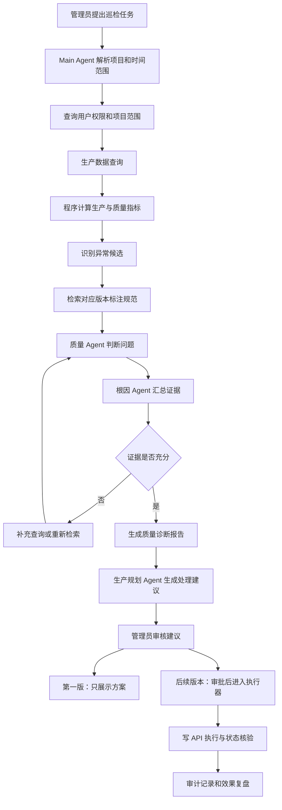
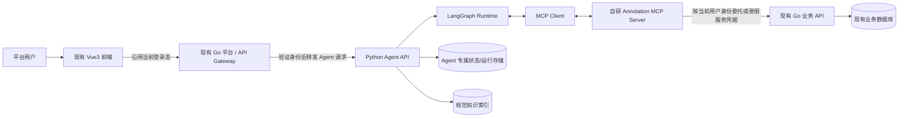
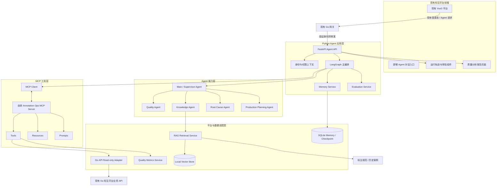
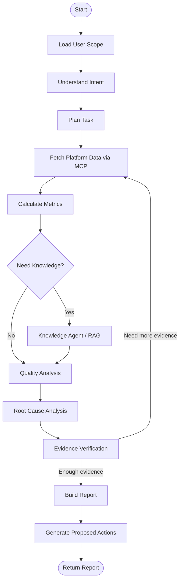
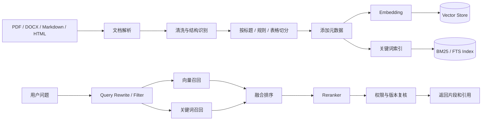
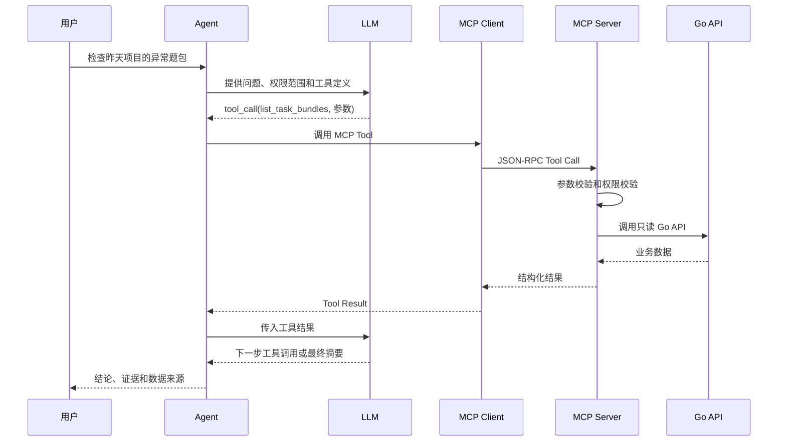

# Annotation Ops Agent：智能标注生产运营与质量治理 Agent

> **项目类型：** 企业级 Agent 实战项目  
> **文档版本：** V1.1（基于现有 Vue3 + Go 完整标注平台修订）  
> **制定日期：** 2026-11-02  
> **学习方式：** 原理与业务落地并重、逐阶段交付  
> **接入策略：** 复用现有 Vue3 + Go 标注平台；第一版通过真实 Go API 严格只读接入；写操作后续通过审批和独立执行器逐步开放  
> **核心原则：** 不重建标注平台、不替换现有 Vue3 前端和 Go 后端；Agent 作为独立智能能力层接入，不改造成熟业务核心流程，不为了展示技术堆叠 Agent，不把模型输出当作事实

---

## 目录

1. [项目定位与目标](#1-项目定位与目标)
2. [业务场景与核心闭环](#2-业务场景与核心闭环)
3. [业务范围与边界](#3-业务范围与边界)
4. [总体技术架构](#4-总体技术架构)
5. [技术选型与理由](#5-技术选型与理由)
6. [核心业务对象与数据模型](#6-核心业务对象与数据模型)
7. [自研 MCP Server 设计](#7-自研-mcp-server-设计)
8. [Agent 编排与子 Agent 设计](#8-agent-编排与子-agent-设计)
9. [RAG 知识检索系统](#9-rag-知识检索系统)
10. [记忆系统设计](#10-记忆系统设计)
11. [质量分析与异常诊断](#11-质量分析与异常诊断)
12. [工具调用、反思与执行安全](#12-工具调用反思与执行安全)
13. [微调策略](#13-微调策略)
14. [对外 API 与运行轨迹](#14-对外-api-与运行轨迹)
15. [项目目录建议](#15-项目目录建议)
16. [10 周学习与开发路线](#16-10-周学习与开发路线)
17. [第一周详细实施任务](#17-第一周详细实施任务)
18. [验收、测试与评测体系](#18-验收测试与评测体系)
19. [安全、权限与数据保护](#19-安全权限与数据保护)
20. [部署演进路线](#20-部署演进路线)
21. [风险与常见误区](#21-风险与常见误区)
22. [GitHub 参考项目与学习资料](#22-github-参考项目与学习资料)
23. [项目里程碑与最终交付清单](#23-项目里程碑与最终交付清单)
24. [开始实施前需要准备的真实平台资料](#24-开始实施前需要准备的真实平台资料)

---

# 1. 项目定位与目标

## 1.1 项目名称

**Annotation Ops Agent——智能标注生产运营与质量治理系统**

它不是简单的标注平台聊天机器人，也不是只会检索规范的知识库问答系统。它是一套嵌入现有语音标注业务的智能运营系统，能读取真实生产数据、理解标注规范、分析异常、形成可验证的诊断、提出运营方案，并在后续版本中通过审批安全地执行业务操作。

> **现状前提（重要）：** 用户已经拥有一套完整可运行的数据标注平台，前端为 Vue3，后端为 Go，包含现有业务页面、用户体系、权限体系、任务/题包/题目等业务流程。本项目不再开发新的标注平台，也不新建另一套管理后台。Vue3 + Go 平台是唯一业务系统和事实来源；Agent 是附加的智能能力层。

本项目需要新增的是 Python Agent 服务、自研 Annotation MCP Server、RAG/Memory/评测等 Agent 能力，以及现有 Vue3 平台中的 Agent 入口和必要的轻量集成。现有 Go 后端只在确有必要时增加薄的 Agent 网关/身份委托接口或只读业务 API，不重写已有业务服务。

## 1.2 最终业务目标

管理员可以向 Agent 提出自然语言任务，例如：

> 帮我检查昨天语音标注项目的生产情况，找出质量异常的题包，分析异常原因，结合当前版本的标注规范给出证据，并生成抽检或返工方案。先不要执行，给我审批。

系统需要能够：

1. 识别用户意图、项目范围和时间范围。
2. 根据当前用户权限读取真实 Go 平台数据。
3. 查询任务、题包、题目、标注记录、人员、工作组等业务信息。
4. 计算生产进度、处理时长、质量指标和异常候选。
5. 检索当前项目适用的标注规范、规则版本和历史争议案例。
6. 把数据事实、规范依据和模型推断分开表达。
7. 对复杂任务拆解步骤，并调用专业子 Agent 完成分析。
8. 对关键结论进行交叉校验，证据不足时补充查询或降低结论置信度。
9. 生成抽检、返工、承接人调整等运营建议。
10. 在管理员审批后，才允许未来版本的执行器实施写操作。
11. 记录完整的工具调用轨迹、审批记录和审计信息。
12. 把人工确认的处理结果转化为评测案例和经过审核的长期记忆。

## 1.3 核心学习目标

通过一个真实业务项目，系统掌握以下模块：

| 技术模块 | 必须掌握的原理 | 在项目中的落地 |
|---|---|---|
| LLM 与 Prompt | 上下文、角色指令、结构化输出、上下文窗口 | 质量分析与任务规划 |
| Function Calling | 模型生成工具请求、参数 Schema、工具结果回传 | 查询 Go API、计算质量数据 |
| MCP | Host、Client、Server、JSON-RPC、Tools、Resources、Prompts、Transport | 自己开发标注业务 MCP Server |
| RAG | 解析、切分、Embedding、召回、重排、引用、评测 | 标注规范和历史案例检索 |
| 记忆系统 | 短期状态、长期记忆、记忆写入、更新、过期、冲突处理 | 项目经验和历史问题记忆 |
| Agent 编排 | State、Node、Edge、Reducer、Checkpoint、条件路由 | LangGraph 质量巡检流程 |
| 子 Agent | 职责边界、委派、结果协议、并行执行 | 质量、规范、根因、生产规划 Agent |
| 迭代反思 | 证据校验、重试条件、停止条件、反思边界 | 质量诊断复核 |
| Human-in-the-loop | 暂停、审批、拒绝、修改、恢复执行 | 返工和重新分配审批 |
| 微调 | SFT、LoRA、数据集构建、验证集、防止数据泄漏 | 缺陷分类或结构化诊断实验 |
| Agent 评测 | 检索评测、工具评测、任务成功率、轨迹分析 | 建立可回归的业务评测集 |

## 1.4 设计原则

- **先业务，后技术。** 每一个 Agent 能力必须对应真实业务需求。
- **先单 Agent，后多 Agent。** 不在第一周就堆多个 Agent。
- **先只读，后写入。** 第一版不允许 Agent 修改生产数据。
- **先可解释，后自动化。** 每个质量结论都要能追溯到数据和规范。
- **业务事实以 Go 平台为准。** Agent 的 Memory 和向量库不能替代最新业务状态。
- **统计与模型分工。** 精确计数、比率和统计指标由程序计算，LLM 负责解释和规划。
- **所有动作可审计。** 工具调用、数据来源、审批和执行结果均可追踪。
- **可逐步交付、可回滚。** 每一阶段独立运行，失败时可以退回上一阶段。

---

# 2. 业务场景与核心闭环

## 2.1 主要使用角色

| 角色 | 主要需求 | Agent 可提供的能力 |
|---|---|---|
| 平台管理员 | 全局生产监控、异常处理、调度 | 跨项目分析、异常报告、方案审批 |
| 项目管理员 | 项目进度、质量和规范管理 | 项目质量巡检、规范问答、返工建议 |
| 工作组管理员 | 组内任务、成员和产能管理 | 工作组生产分析、承接情况分析 |
| 质检员/审核员 | 复核问题、判断规范争议 | 争议检索、问题归因、复核摘要 |
| 标注员 | 理解规范、查看个人问题与改进建议 | 规范解释、个人质量反馈（权限允许时） |

权限必须继承现有 Go 平台，不允许模型自行判断用户是否有权看到某个项目或人员信息。

## 2.2 三个核心业务模块

### A. 智能生产侦察员

负责回答“生产情况怎么样、哪里可能有问题”。

功能：

- 查询任务、题包、题目和人员生产情况。
- 统计已分配、已承接、进行中、已完成、待审核等状态（以真实平台状态定义为准）。
- 识别积压题包、长时间无进展题包、产能异常、质量指标变化。
- 比较不同项目、题型、时间窗口和工作组的表现。
- 生成日报、周报和异常清单。

### B. 标注规范专家

负责回答“什么是正确的标注、当前结果是否违反规范”。

功能：

- 检索项目规范、标注规则、更新说明和历史争议案例。
- 识别规范版本和适用范围。
- 对具体问题引用对应规范条款。
- 区分明确违规、可能违规、规则存在歧义、信息不足。
- 对规范变更给出前后版本差异摘要。

### C. 智能生产调度员

负责回答“应该怎么处理、如何安全落地”。

功能：

- 根据异常生成抽检计划。
- 生成题包返工建议。
- 根据承接人负载、技能、历史质量和业务约束提出重新分配候选。
- 生成待审批业务动作。
- 后续在审批后，通过独立执行器调用真实平台写 API。

第一版只生成建议，不实际写入 Go 平台。

## 2.3 代表性业务闭环

**场景：昨天某语音项目质量下降，管理员要求自动检查并提出整改方案。**



## 2.4 项目差异化能力

本项目不以“能聊天、能查知识”为目标，而要实现四个层次：

1. **知道事实：** 能正确查询真实平台当前数据。
2. **理解规则：** 能找到适用的标注规范并解释条款。
3. **形成判断：** 能用数据和规范解释异常，不把猜测当结论。
4. **推动闭环：** 能形成受审批约束的运营方案，并检查后续效果。

---

# 3. 业务范围与边界

## 3.1 第一版纳入范围

- 真实 Go API 只读接入。
- 项目、任务、题包、题目、标注记录和人员信息查询（以当前 API 和权限允许为准）。
- 任务和题包生产状态分析。
- 标注规范 RAG。
- 单 Agent 工具调用。
- 自研 MCP Server。
- 基础质量规则和统计分析。
- 对话、运行轨迹和引用来源展示。

## 3.2 后续纳入范围

- 长期记忆和项目经验沉淀。
- 多 Agent 协作。
- 多维质量分析和异常归因。
- 返工、抽检、题包重新分配建议。
- 审批流程和受控写操作。
- 微调实验。
- 质量治理效果闭环和自动巡检。

## 3.3 暂不做的内容

- 不重做现有标注平台。
- 不修改成熟 Go 业务流程。
- 不让 Agent 直接访问生产数据库。
- 不让 LLM 直接生成 SQL 并执行。
- 不在第一阶段开放生产写 API。
- 不因技术清单而提前微调模型。
- 不一开始引入 Docker、MySQL、Redis、Kubernetes 等基础设施。
- 不一开始做完全自治的多 Agent 群体。

## 3.4 现有业务模型约束

现有平台的核心关系按已知业务理解为：

```text
任务 Task
  └── 题包 Bundle
        └── 题目 Question
              └── 标注记录 Annotation
```

题包承接关系需要特别注意：**题包分配给承接人后，题包下所有题目按现有业务规则统一进入该承接人的处理范围**。Agent 不应把“题包承接”和“单题领取”混为一谈。

如果平台还存在工作组关系，需遵循现有约束：

- 一个用户可以管理多个工作组。
- 一个用户最多属于一个工作组（以平台实际规则为准）。
- 工作组管理员和普通成员身份互斥。

上述规则在第一阶段通过 API 文档和真实返回验证，最终以现有 Go 系统为准。

## 3.5 现有平台与 Agent 的边界（本项目最重要的架构约束）

你已经有完整的 Vue3 + Go 标注平台，因此最终系统是“现有业务平台 + 独立 Agent 能力层”，而不是另起炉灶重做一套产品。

| 能力 | 归属 | 原则 |
|---|---|---|
| 登录、用户、角色、权限 | 现有 Go 平台 | 继续使用现有认证授权，不在 Agent 里复制一套用户权限系统 |
| 任务、题包、题目、标注记录 | 现有 Go 平台 | 唯一事实来源，Agent 通过已授权 API 查询 |
| 工作组、人员关系、业务状态流转 | 现有 Go 平台 | 遵循现有规则，不在 Agent 数据库维护第二份业务状态 |
| 标注规范和历史案例 | Agent 知识层 | 建立独立知识索引，保留来源、项目范围和版本 |
| 对话、运行状态、Checkpoint | Agent 服务 | 单独持久化，不污染标注业务表 |
| MCP Tools / Resources / Prompts | 自研 MCP Server | 把现有平台 API 能力包装成语义明确、权限受控的工具 |
| Vue3 Agent 页面 | 现有 Vue3 前端 | 以新增路由/菜单/组件方式集成，沿用现有 UI、登录态和权限控制 |
| 质量分析与 Agent 编排 | Python Agent 服务 | 不替代 Go 业务服务中的确定性规则；复杂统计由代码计算 |

**明确不做：** 不开发 React 前端；不重写 Go 任务/题包/标注服务；不在 Agent 中直连生产数据库；不创建模拟版标注平台。自动化测试可以使用脱敏 fixture 或 mock HTTP 响应，但那只是测试替身，不是业务数据源。

**推荐接入路径：**



前端到 Agent API 的认证接入有两种可选方式，实施时按现有平台能力选择：

1. **优先方式：** Vue3 仍走现有 Go 网关，由 Go 验证当前登录态，再通过服务间认证把可信的用户身份、租户/项目范围和请求 ID 传给 Python Agent API。
2. **备选方式：** 如果现有登录 Token 可以由 Agent API 安全验证，Vue3 可以在现有网关策略允许的情况下直接请求 Agent API。此时必须验证签名、过期时间、受众和权限范围。

MCP Server 调用 Go API 时，必须保留调用者身份和授权边界。优先使用平台支持的用户委托 Token；如果只能使用服务账号，则必须在服务端重新执行项目范围/角色授权，不能仅凭 Agent 传来的 `user_id` 或 `project_id` 放行。任何从浏览器传来的身份字段都不能单独作为可信身份凭据。

**部署关系：** Agent API 与 MCP Server 可以独立进程部署在现有平台旁边；初期允许同一台开发机运行。生产部署时再由现有网关或内部服务发现接入。MCP Server 不需要直接访问 Go 平台数据库。

---

# 4. 总体技术架构

## 4.1 技术分层



## 4.2 核心调用链

第一版的主要链路：

```text
现有 Vue3 页面
  -> 现有 Go 网关（或经验证的 Agent API 入口）
      -> FastAPI /agent/runs
      -> 身份认证和授权范围
      -> LangGraph Main Agent
          -> 获取可用 MCP Tools
          -> 模型决定调用哪个 Tool
          -> MCP Client 调用自研 MCP Server
              -> Tool 参数校验
              -> 权限范围校验
              -> Go API Read-only Adapter
              -> 现有 Go 平台 API
          -> 工具结果返回模型
          -> 组织最终答案和数据来源
      -> 返回答案、运行状态和轨迹
```

## 4.3 服务职责边界

| 服务 | 负责什么 | 不负责什么 |
|---|---|---|
| 现有 Vue3 前端 | 增加 Agent 对话、报告、轨迹和审批入口 | 不新建 React 应用，不绕过现有登录和权限体系 |
| FastAPI | 用户请求、身份上下文、运行管理 | 不承载全部 Agent 业务逻辑 |
| LangGraph | 状态、节点、路由、暂停恢复 | 不直接访问生产数据库 |
| MCP Server | 给 Agent 暴露受控业务能力 | 不提供任意 SQL 或任意 HTTP 请求 |
| Go API Adapter | 对接已有 Go API、统一错误和分页 | 不改变 Go 业务语义 |
| Quality Service | 精确指标和规则计算 | 不让 LLM 自己算总量和比率 |
| RAG Service | 文档解析、召回、重排、引用 | 不充当实时业务数据源 |
| Memory Service | 保存会话状态和经过审核的经验 | 不保存需要实时查询的业务状态 |

---

# 5. 技术选型与理由

## 5.1 推荐技术栈

| 层级 | 推荐 | 说明 |
|---|---|---|
| 前端 | 现有 Vue3 + 当前项目使用的 UI 组件库 | 通过新增路由、页面和组件集成 Agent，不引入第二套前端技术栈 |
| Agent API | Python + FastAPI + Pydantic | 便于组织模型调用、MCP 和数据验证 |
| Agent 编排 | LangGraph | 显式状态图、条件边、检查点、人工审批和多 Agent |
| LLM | DeepSeek API（通过配置层接入） | 当前学习环境可先用在线 API，模型与业务代码解耦 |
| Function Calling | 模型 Tool Calls + LangGraph ToolNode/自定义 Tool Adapter | 学会模型生成工具请求到工具结果回传的完整机制 |
| MCP Server | 官方 MCP Python SDK | 自己开发 Server，同时理解 Client、Tools、Resources、Prompts |
| Go API 客户端 | httpx + Pydantic DTO | Python 服务调用现有 Go REST API |
| 业务与审计存储 | SQLite | 本地开发和轻量持久化 |
| 知识向量库 | Chroma 本地持久化（第一版） | 便于本地 RAG 实验；后续可替换 Qdrant |
| 关键词检索 | SQLite FTS5 或 BM25 | 规范编号、标签和专有名词的精确召回 |
| Embedding | 可替换 Embedding Provider；优先评估本地中文模型或经批准的 API | 避免把敏感标注规范未经批准发往外部服务 |
| Reranker | 可替换 Cross-Encoder / API Reranker | 在候选文档上二次排序 |
| 测试 | pytest、httpx Mock、MCP Client 测试、Evaluation Dataset | 单元、集成、轨迹和效果评测 |
| 可观测性 | 结构化日志 + OpenTelemetry；必要时增加 LangSmith 等平台 | 记录每次运行和工具调用，脱敏敏感字段 |

## 5.2 为什么选择 LangGraph

本项目有多步骤、条件分支、可暂停审批、长任务恢复和多专业 Agent 协作需求。LangGraph 的图结构适合将这些流程明确表达出来。

建议学习顺序：

1. State：一次 Agent 运行共享什么状态。
2. Node：每一步具体做什么。
3. Edge：下一步去哪里。
4. Conditional Edge：根据结果走不同分支。
5. Reducer：并行节点返回值如何合并。
6. Checkpointer：如何保存一次运行的状态。
7. Interrupt / Resume：如何等待管理员审批再恢复。
8. Subgraph：如何把专业 Agent 作为子图组合。

## 5.3 Function Calling 和 MCP 的关系

这两个技术不要混淆：

- **Function Calling / Tool Calling：** 模型在上下文中选择一个工具，并输出结构化工具名和参数。模型不会自己执行函数，应用程序负责执行并把结果回传。
- **MCP：** 让工具、资源和提示模板可以通过标准协议被客户端发现和调用。
- **Agent：** 决定是否需要工具、调用顺序、如何处理结果、何时结束任务。

本项目中，MCP Client 从自研 MCP Server 获取工具定义，再把合适的工具 Schema 提供给模型；模型输出 Tool Call 后，由 Agent Runtime 通过 MCP Client 执行。MCP 不是 Function Calling 的替代品，Function Calling 也不是 MCP Server。

## 5.4 版本管理原则

不在项目文档中把所有依赖固定到未经验证的“最新版本”。每阶段开始时：

- 查官方文档和兼容矩阵。
- 在 `pyproject.toml` / `uv.lock` 中锁定实际验证版本。
- 保存 Node 依赖锁文件。
- 为 MCP SDK 注意 v1/v2 的 API 差异，示例代码必须与锁定版本匹配。
- 不随意升级 LangGraph、MCP SDK 或模型 SDK；升级后必须跑完单元测试、集成测试和评测集。

---

# 6. 核心业务对象与数据模型

## 6.1 主要业务实体

| 实体 | 作用 | 关键字段候选 |
|---|---|---|
| Project | 标注项目 | project_id、name、task_type、status、guideline_version |
| Task | 任务 | task_id、project_id、status、created_at、deadline |
| Bundle | 题包 | bundle_id、task_id、status、assignee_id、assigned_at、version |
| Question | 题目 | question_id、bundle_id、payload_ref、status、question_type |
| Annotation | 标注记录 | annotation_id、question_id、annotator_id、result、created_at、version |
| Review | 质检/审核 | review_id、question_id/bundle_id、reviewer_id、decision、issue_type |
| Annotator | 标注员 | annotator_id、status、group_id、skills（如平台提供） |
| WorkGroup | 工作组 | group_id、manager_ids、member_ids（以实际模型为准） |
| Guideline | 标注规范 | guideline_id、project_id、version、effective_at、status |
| QualityCase | 质量案例 | case_id、project_id、issue_type、evidence、resolution、approval_status |
| AgentRun | Agent 执行 | run_id、thread_id、user_id、status、started_at、finished_at |
| ToolCallLog | 工具调用 | call_id、run_id、tool_name、arguments_redacted、result_summary、latency_ms |
| ProposedAction | 待审批动作 | action_id、action_type、target_ids、payload、status、idempotency_key、expected_version |

以上字段是 Agent 侧的候选数据契约，不代表现有 Go 数据库字段。平台字段映射必须以真实 API 文档和实际响应为准。

## 6.2 质量数据与业务数据分离

- 业务数据：从 Go API 实时查询。
- 统计结果：由 Python Quality Service 根据查询结果计算。
- 知识数据：来自规范、规则和审核案例。
- 记忆数据：来自 Agent 对话和人工确认的经验。

如果 Go API 的统计结果与 Agent 自己计算结果不一致，应先确认统计口径、分页完整性和时间边界，不能直接选择看起来更合理的一方。

## 6.3 时间范围和数据口径

所有分析请求都需要明确：

- 时区：优先使用平台业务时区，时间存储统一时区，界面显示本地时间。
- 时间范围：`start_time`、`end_time`，采用左闭右开区间 `[start, end)`。
- 状态范围：明确统计哪些业务状态。
- 去重规则：按题目、标注版本还是最终审核记录去重。
- 统计粒度：项目、任务、题包、题型、承接人、标注员或工作组。
- 数据完整性：分页是否全部读取、是否存在延迟同步。

没有明确口径时，Agent 应先追问或把口径作为报告前提，不可随意编造。

---

# 7. 自研 MCP Server 设计

## 7.1 服务名称和职责

服务目录：`services/annotation-mcp-server/`  
服务名称：`annotation-ops-mcp-server`

它是整个项目的核心交付物之一。我们要自己写 MCP Server，而不是仅安装和调用别人的 MCP Server。

Server 负责：

- 声明可用的 Tools、Resources 和 Prompts。
- 校验工具输入参数。
- 获取并验证调用者身份上下文。
- 根据调用者权限控制数据范围。
- 调用业务 Adapter 或 Quality Service。
- 标准化工具输出和错误。
- 记录脱敏后的工具审计信息。

## 7.2 MCP 三类原语的业务设计

### Tools：模型可选择调用的业务动作

**第一版只开放只读工具。** 建议先从少量工具开始，工具描述要明确、粒度合理、参数可验证。

| 工具名 | 输入 | 输出 | 风险等级 |
|---|---|---|---|
| `list_accessible_projects` | filter、page、page_size | 当前用户可见项目列表 | 低，只读 |
| `get_project_overview` | project_id、time_range | 项目进度摘要 | 低，只读 |
| `list_tasks` | project_id、status、time_range、page | 任务列表 | 低，只读 |
| `list_task_bundles` | task_id、status、assignee_id、page | 题包列表 | 低，只读 |
| `get_bundle_detail` | bundle_id | 题包状态、承接信息、题目数量等 | 低，只读 |
| `get_bundle_questions` | bundle_id、page、page_size | 题目摘要 | 中，只读，注意数据量 |
| `get_question_annotations` | question_id | 标注记录和审核结果摘要 | 中，只读，可能含敏感内容 |
| `get_annotator_profile` | annotator_id、time_range | 授权范围内人员统计 | 中，只读，个人数据 |
| `get_quality_statistics` | scope、time_range、metrics | 质量统计指标 | 低，只读 |
| `get_production_statistics` | scope、time_range、group_by | 生产进度和效率指标 | 低，只读 |
| `sample_questions` | bundle_id、sample_size、strategy | 抽样题目 ID 和抽样依据 | 低，只读 |
| `search_guidelines` | query、project_id、version、filters | 规范检索结果和引用 | 低，只读 |
| `get_guideline` | guideline_id、version | 指定规范内容 | 低，只读 |

不要一次性全部实现。第一周只实现 3 个基础只读工具；第二周将工具正式迁入 MCP Server。

### Resources：应用可提供给模型的上下文资源

示例 URI：

- `annotation://projects/{project_id}/overview`
- `annotation://projects/{project_id}/guidelines/{version}`
- `annotation://metrics/{metric_name}`
- `annotation://projects/{project_id}/schema`
- `annotation://quality-cases/{case_id}`

Resources 更适合读取确定的上下文，例如指标解释、指定版本规范和项目结构。动态搜索通常使用 Tool，例如 `search_guidelines`。

### Prompts：用户或应用选择的可复用模板

建议提供：

- `daily_production_review`：生产日报巡检。
- `bundle_quality_audit`：题包质量审查。
- `annotator_quality_review`：标注员质量分析。
- `guideline_conflict_analysis`：规范冲突分析。
- `root_cause_analysis`：异常根因分析。
- `rework_plan`：返工方案生成。

Prompts 是可复用模板，不应把权限规则只放在 Prompt 中。真正的权限必须由服务端强制执行。

## 7.3 MCP 传输方式

建议：

- 本地开发和协议教学：先使用 `stdio`，易于单进程调试。
- Agent API 与 MCP Server 分开运行后：使用官方 SDK 当前支持的 HTTP 传输方式，优先评估 Streamable HTTP。
- 不为新项目优先采用旧式 SSE 传输，除非现有客户端兼容性确有要求。

具体 API 与 transport 写法，以最终锁定的官方 MCP Python SDK 版本为准。

## 7.4 MCP Tool 标准输出

所有 Tool 输出尽量结构化：

```json
{
  "ok": true,
  "data": {
    "bundle_id": "BUNDLE-001",
    "status": "in_progress",
    "question_count": 120,
    "completed_count": 78,
    "assignee": {
      "id": "USER-021",
      "display_name": "用户脱敏名称"
    }
  },
  "meta": {
    "source": "annotation-platform-api",
    "fetched_at": "2026-11-02T08:00:00Z",
    "request_id": "req_xxx",
    "partial": false
  },
  "warnings": []
}
```

异常统一表达：

```json
{
  "ok": false,
  "error": {
    "code": "PLATFORM_PERMISSION_DENIED",
    "message": "当前用户无权查看该题包",
    "retryable": false
  },
  "meta": {
    "request_id": "req_xxx"
  }
}
```

不要把内部堆栈、Token、完整用户隐私字段直接回传给模型。

## 7.5 自研 MCP Server 的阶段验收

- MCP Client 能连接 Server。
- 能列出 Tools、Resources、Prompts。
- 能发现工具 Schema 并按 Schema 调用。
- 输入错误时得到可理解错误，不产生副作用。
- 没有权限的数据不可读取。
- 输出符合统一 JSON 契约。
- 有超时、日志、请求 ID 和单元测试。
- 第一版所有工具均为只读。

---

# 8. Agent 编排与子 Agent 设计

## 8.1 主 Agent：Supervisor / Main Agent

主要职责：

- 识别用户意图。
- 明确项目、时间范围和分析目标。
- 检查是否缺少关键参数。
- 规划任务步骤。
- 决定调用哪些工具和子 Agent。
- 汇总证据与分析结果。
- 判断是否需要继续补充数据。
- 生成结构化报告。

Main Agent 不应亲自完成全部复杂计算，也不应该有无限制的业务工具权限。

## 8.2 子 Agent 角色

| 子 Agent | 负责内容 | 输入 | 输出 |
|---|---|---|---|
| Quality Agent | 生产指标、质量指标、异常候选 | 指标数据、业务范围 | 异常列表、计算口径、样本量 |
| Knowledge Agent | 检索规范、规则和案例 | 项目、题型、查询问题 | 条款、版本、引用、适用范围 |
| Root Cause Agent | 结合指标和规范解释原因 | 异常、标注记录、知识证据 | 根因候选、证据链、置信程度 |
| Production Planning Agent | 生成抽检、返工、调度建议 | 诊断结果、负载和业务约束 | 方案、影响范围、风险、审批要求 |

必要时增加 Data Analysis Agent，但第一版先用确定性 Python 计算服务承担数据计算，避免用 Agent 代替普通统计代码。

## 8.3 Agent 之间的输入输出协议

子 Agent 应使用结构化结果，不依赖自然语言长篇交接。

例如异常诊断：

```json
{
  "issue_id": "ISSUE-001",
  "issue_type": "annotation_disagreement",
  "scope": {
    "project_id": "PROJECT-001",
    "bundle_id": "BUNDLE-001"
  },
  "severity": "medium",
  "facts": [
    {
      "statement": "抽样 30 道题中有 8 道存在审核分歧",
      "source_ids": ["review-1", "review-2"],
      "calculation": "8 / 30"
    }
  ],
  "guideline_evidence": [
    {
      "document_id": "GUIDE-001",
      "version": "v3",
      "section": "2.4.1",
      "quote": "脱敏后的规范引用"
    }
  ],
  "hypotheses": [
    {
      "reason": "规则理解可能不一致",
      "evidence_for": ["..."],
      "evidence_against": [],
      "confidence": "medium"
    }
  ],
  "missing_information": []
}
```

输出中必须区分：

- `facts`：由平台数据或确定性程序支持的事实。
- `guideline_evidence`：规范原文或可靠引用。
- `hypotheses`：模型提出的原因假设。
- `missing_information`：当前证据无法确定的部分。

## 8.4 LangGraph 状态设计

主流程 State 可以从以下结构开始：

```python
class AgentState(TypedDict, total=False):
    user_id: str
    tenant_id: str
    project_scope: list[str]
    thread_id: str
    user_query: str
    intent: str
    time_range: dict
    plan: list[dict]
    tool_results: list[dict]
    production_metrics: dict
    quality_findings: list[dict]
    guideline_evidence: list[dict]
    root_cause_report: dict
    proposed_actions: list[dict]
    validation_errors: list[str]
    final_report: dict
    retry_count: int
    approval_status: str
```

State 字段要少而明确。不要把所有原始标注内容、所有文档全文和无关日志永久塞进 State。

Reducer 建议：

- `tool_results`：按调用记录追加。
- `quality_findings`：按 issue_id 去重合并，避免重复异常。
- `retry_count`：替换为最新计数。
- `final_report`：替换。
- `validation_errors`：追加，并在每轮开始时明确是否清空或保留。

## 8.5 推荐主图



第一版可以把节点合并成一个简单图：`intent -> tool_call -> summarize`。后续逐步拆分，不需要第一天实现完整主图。

---

# 9. RAG 知识检索系统

## 9.1 为什么需要 RAG

标注规范可能随项目、业务类型和时间版本变化。将规范直接写进 Prompt 或 Fine-tuning 会导致更新成本高、版本不透明，也无法可靠追溯具体条款。

RAG 负责在回答问题时检索适用的外部知识，并让 Agent 提供引用证据。

## 9.2 知识库范围

第一批知识源建议：

1. 语音标注总体规范。
2. 项目专属标注规范。
3. 题型和字段说明。
4. 规范更新记录与版本差异。
5. 质检问题类型及判定规则。
6. 历史争议案例和审核结论。
7. 常见问题、培训材料和业务术语。
8. 质量指标定义和计算口径。

不要一开始把公司所有文档都导入。先选一个真实项目的一套规范和少量审核案例做端到端检索。

## 9.3 RAG 数据流水线



## 9.4 Chunk 切分原则

标注规范不建议只按固定字符数机械切块。

优先级：

1. 按章节标题和条款编号切分。
2. 尽量让一个 Chunk 表达一个完整规则。
3. 对表格保留表头、字段说明和行关系。
4. 对过长章节做父子切分：子 Chunk 用于检索，父 Chunk 用于补充上下文。
5. 保留必要的前后条款关系，避免单独检索一句话导致误解。
6. 对条款编号、关键词和规范版本建立关键词索引。

## 9.5 元数据设计

```json
{
  "document_id": "GUIDE-PROJ-001-V3",
  "project_id": "PROJECT-001",
  "document_type": "annotation_guideline",
  "version": "v3",
  "section_id": "2.4.1",
  "section_title": "说话人切分规则",
  "task_type": "speech_transcription",
  "language": "zh-CN",
  "effective_from": "2026-10-01T00:00:00Z",
  "effective_to": null,
  "permission_scope": ["project_admin", "quality_reviewer"],
  "source_file": "speech-guideline-v3.pdf",
  "page_start": 12,
  "page_end": 13,
  "content_hash": "sha256:..."
}
```

重要：权限过滤必须在检索阶段执行，而不是先召回全部内容再让 LLM 自己判断能否看。

## 9.6 检索策略

推荐逐步演进：

- V1：向量检索，先理解 Embedding 和相似度。
- V2：关键词检索（SQLite FTS5 或 BM25）。
- V3：混合检索，融合向量召回和关键词召回，可用 Reciprocal Rank Fusion 等方法。
- V4：Reranker 对候选片段二次排序。
- V5：Query Rewrite、多轮检索、父子 Chunk、版本过滤。

不能只根据“回答看起来不错”判断 RAG 成功。必须建立带标准答案和标准证据的评测集。

## 9.7 RAG 引用规范

回答应展示：

- 规范名称。
- 版本。
- 章节或条款编号。
- 页码（如果文档解析可获取）。
- 命中的原文片段。
- 文档来源链接或内部文档 ID。

若找不到适用规范，必须明确写“当前知识库未检索到足够依据”，不允许模型自行补写规则。

---

# 10. 记忆系统设计

## 10.1 记忆不等于 RAG，也不等于业务数据库

| 类型 | 解决什么问题 | 数据来源 | 是否能作为当前业务事实 |
|---|---|---|---|
| 短期记忆 | 当前任务执行到哪里、前文说了什么 | 当前 Thread 的 Agent State | 不能替代实时平台查询 |
| 长期语义记忆 | 项目长期约定、已确认的业务经验 | 人工确认、审核后的案例 | 只能作为辅助上下文 |
| 情景记忆 | 以前发生过什么问题、如何解决 | 历史 Run、审核记录 | 不能直接推断当前状态 |
| 程序性记忆 | 已批准的流程偏好、报告模板 | 管理员配置 | 不能覆盖系统权限和安全策略 |
| RAG 知识 | 正式规范、制度和版本文档 | 文档库 | 依赖版本和有效期 |
| 业务数据 | 当前题包状态、当前承接人等 | Go 平台 API | 以平台实时返回为准 |

## 10.2 短期记忆

使用 LangGraph Checkpointer 保存一个 Thread 的图状态和对话上下文。

典型场景：

用户先问“检查昨天的项目 A”，接着问“把异常题包按严重程度排序”，Agent 应继续使用当前 Thread 的项目 A 和昨天时间范围，而不是重新猜测。

需要控制 State 大小：长文档和大量原始记录存外部存储，State 仅保存引用、摘要和必要字段。

## 10.3 长期记忆

建议按以下类别管理：

- `project_preference`：项目管理员确认的分析偏好。
- `verified_quality_case`：人工复核确认的质量案例。
- `resolution_pattern`：某类问题被确认有效的解决方案。
- `report_preference`：用户偏好的报告结构。
- `business_definition`：经业务负责人确认的业务口径。

每条记忆要保存：

- memory_id
- scope（用户、项目、工作组等）
- memory_type
- content
- source_run_id / source_case_id
- created_by
- reviewed_by
- confidence / status
- created_at / updated_at
- expires_at（适用时）
- version

## 10.4 记忆写入规则

不允许模型在一次对话中自行把推断写入长期记忆。

正确流程：

```text
Agent 发现可能有用的经验
  -> 形成 Memory Candidate
  -> 检查是否包含隐私或未经证实内容
  -> 管理员 / 授权用户确认
  -> 写入长期记忆
  -> 之后检索时带上来源和审核状态
```

## 10.5 记忆冲突和遗忘

- 新旧规范冲突时，以有效版本和业务系统指定版本为准。
- 长期记忆与最新 API 数据冲突时，以最新 API 数据为准。
- 低置信、未经确认的候选记忆不应进入正式检索空间。
- 支持按用户、项目和记忆类型删除或失效。
- 对过期经验设定 TTL 或定期复核。
- 记录记忆的来源和更新时间，避免“模型记得但没人知道从哪里来的”。

---

# 11. 质量分析与异常诊断

## 11.1 先建立可解释的指标体系

不要一开始就设计一个“综合质量分数”并让 LLM 给人排名。先定义可核查的单项指标。

### 生产效率类

- 题包分配数量。
- 题包承接数量。
- 题目完成数量。
- 完成率。
- 待处理积压量。
- 超时题包数量。
- 平均处理时长、中位处理时长和 P90。
- 人员负载分布。

每个指标必须明确分母、状态范围、时间窗口和去重口径。

### 标注质量类

根据实际标注任务类型选择：

| 业务类型 | 可考虑的指标 | 注意事项 |
|---|---|---|
| ASR 转写 | WER、CER | 需有可信参考文本，明确标准化规则 |
| 说话人分离 | DER、JER | 需要参考说话人区间和重叠语音口径 |
| 时间戳标注 | 边界偏差、区间 IoU | 先明确允许误差 |
| 分类/标签 | Precision、Recall、F1、混淆矩阵 | 需要可信 Ground Truth |
| 多人标注一致性 | Cohen's Kappa、Fleiss' Kappa 等 | 指标适用条件和样本结构不同，不能混用 |
| 规范/格式检查 | 规则通过率、必填字段错误率 | 可由确定性规则校验 |
| 质检结果 | 审核通过率、退回率、复核一致率 | 要考虑抽检策略和样本偏差 |

若没有 Ground Truth，不应把“模型判断的正确率”包装成实际准确率。

## 11.2 异常检测先做规则，再做模型

第一版建议做确定性规则，例如：

- 题包长时间没有进展。
- 完成率低于经过业务确认的阈值。
- 质检退回率较历史基线明显上升。
- 某题型的错误类型集中增加。
- Gold 题表现变化（如果平台有 Gold 机制）。
- 同一题多个标注结果出现明显分歧。
- 单位时间产出异常偏离同类任务基线。

规则必须支持项目、题型和时间窗口配置。不要用一个阈值评价所有标注员。

## 11.3 标注员质量分析的公平性

Agent 不应因为一个人某天的少量错误就给出“能力差”“不合格”等结论。

报告至少展示：

- 样本量。
- 统计时间范围。
- 题型和难度分布（如果可获取）。
- 使用的质量指标和计算口径。
- 与什么基线比较。
- 结论的不确定性。
- 是否经过人工复核。

产量高不代表质量高；样本少时不应做确定性排名。人员评价应以有代表性的审核结果和业务流程为准。

## 11.4 异常诊断报告结构

```json
{
  "report_id": "QR-2026-001",
  "scope": {
    "project_id": "PROJECT-001",
    "start_time": "2026-11-01T00:00:00+08:00",
    "end_time": "2026-11-02T00:00:00+08:00"
  },
  "summary": "项目生产总体稳定，但两个题包存在质量异常候选。",
  "data_quality": {
    "complete": true,
    "warnings": []
  },
  "findings": [
    {
      "finding_id": "F-001",
      "severity": "medium",
      "scope": {"bundle_id": "BUNDLE-001"},
      "facts": [],
      "guideline_evidence": [],
      "hypotheses": [],
      "recommended_checks": []
    }
  ],
  "limitations": ["该结论基于抽样复核数据，不代表全部题目。"],
  "generated_at": "2026-11-02T10:00:00+08:00"
}
```

---

# 12. 工具调用、反思与执行安全

## 12.1 标准工具调用流程



## 12.2 Agent 迭代反思

反思不是让模型无限循环地“再思考一次”。它必须有明确验证目标。

推荐流程：

1. Draft：生成初步诊断。
2. Verify：验证数据来源、计算、规范版本和引用。
3. Detect Gap：找出证据缺口。
4. Revise：必要时补充查询或重检索。
5. Stop：达到条件后结束。

停止条件示例：

- 关键指标均有来源和计算口径。
- 规范引用匹配项目和有效版本。
- 没有未解释的数据冲突。
- 最多补充检索/查询 1–2 轮。
- 仍然缺证据时输出“不确定”，而不是继续无限调用。

## 12.3 工具调用安全分级

| 等级 | 示例 | 第一版策略 |
|---|---|---|
| R0 只读公共指标 | 指标定义、公开枚举 | 可开放 |
| R1 只读业务数据 | 项目、任务、题包状态 | 按当前用户权限开放 |
| R2 只读敏感数据 | 标注内容、人员表现 | 最小字段、严格授权、脱敏 |
| W1 生成建议 | 生成返工/分配方案但不执行 | 后续开放，无副作用 |
| W2 写入待审批动作 | 创建待审批申请 | 后续开放，必须审计 |
| W3 生产写操作 | 实际返工、题包分配、状态流转 | 最后开放，审批、幂等和版本校验缺一不可 |

## 12.4 未来写操作的安全流程

第一版不实现写操作。后续实现时必须拆成“计划”和“执行”两个阶段：

```text
Agent 生成业务方案
  -> 创建 ProposedAction（待审批）
  -> 人工查看影响范围和目标对象
  -> 审批人批准 / 修改 / 拒绝
  -> 执行器重新读取 Go API 最新状态
  -> 检查 expected_version 和业务前置条件
  -> 使用 idempotency_key 发起写请求
  -> 查询最终状态确认操作结果
  -> 记录审计日志
```

不能让模型拥有一个通用 `execute_any_api` 或任意 SQL 工具。

---

# 13. 微调策略

## 13.1 微调不是第一阶段目标

本项目必须学习微调，但不应该为了覆盖知识点而提前微调。

先用以下手段解决问题：

1. Prompt 和结构化输出。
2. 工具定义和参数 Schema。
3. RAG 和版本过滤。
4. 确定性业务规则。
5. Agent 评测和错误分析。

当评测证明问题属于模型稳定性、格式遵循或特定任务分类能力不足，再考虑微调。

## 13.2 适合微调的任务

可能的候选：

- 标注缺陷类型分类。
- 审核意见归类。
- 复杂描述转为标准化问题标签。
- 固定报告结构的格式遵循。
- 某类专业术语识别。

## 13.3 不适合用微调解决的问题

- 频繁更新的标注规范知识：优先 RAG。
- 当前题包状态：必须查 Go API。
- 人员当前负载：必须查实时业务数据。
- 权限控制：必须由代码强制执行。
- 业务动作审批：必须由工作流和服务端控制。

## 13.4 微调实验流程

```text
人工审核通过的案例
  -> 清理隐私和敏感字段
  -> 统一标签体系
  -> 标注数据质量审查
  -> 切分 train / validation / test
  -> 建立 Prompt + RAG 基线
  -> SFT / LoRA 实验
  -> 对照评测
  -> 错误分析
  -> 决定是否上线
```

数据集划分应避免同一项目、同一原始样本或高度相似案例同时进入训练集和测试集，避免数据泄漏。样本规模和训练方案由具体任务、模型和评测结果决定，不预设“达到某个数量就一定有效”。

---

# 14. 对外 API 与运行轨迹

## 14.1 Agent API 初步设计

这些是新建 Agent 服务的 API，不是现有 Go 平台接口。

| Method | Path | 用途 |
|---|---|---|
| POST | `/api/agent/threads` | 创建对话线程 |
| GET | `/api/agent/threads/{thread_id}` | 获取线程信息 |
| POST | `/api/agent/threads/{thread_id}/runs` | 启动 Agent 任务 |
| GET | `/api/agent/runs/{run_id}` | 查询运行状态 |
| GET | `/api/agent/runs/{run_id}/events` | 获取运行事件/流式输出 |
| GET | `/api/agent/runs/{run_id}/trace` | 查询节点和工具调用轨迹 |
| GET | `/api/agent/reports/{report_id}` | 获取质量报告 |
| GET | `/api/agent/actions/{action_id}` | 后续查看待审批动作 |
| POST | `/api/agent/actions/{action_id}/decision` | 后续审批、拒绝或修改 |

## 14.2 启动 Run 请求示例

```json
{
  "message": "检查项目 A 昨天的生产情况，找出异常题包并分析原因",
  "context": {
    "project_ids": ["PROJECT-001"],
    "time_range": {
      "start": "2026-11-01T00:00:00+08:00",
      "end": "2026-11-02T00:00:00+08:00"
    }
  },
  "mode": "read_only"
}
```

不要信任请求体里任意传入的 `user_id` 作为身份凭证。用户身份必须从经过验证的登录态或服务端签名上下文取得。

## 14.3 运行轨迹需要显示什么

前端建议展示：

- Run ID / Thread ID。
- 当前执行节点。
- Agent 当前执行步骤的摘要。
- 调用了哪个 MCP Tool。
- 工具参数（敏感字段脱敏）。
- 工具返回摘要、数据来源、耗时。
- RAG 命中的文档、版本和条款。
- 重试次数和重试原因。
- 最终结论中的事实、假设和限制。

不要把模型内部隐藏推理链作为产品功能。展示可审计的执行步骤、工具输入输出摘要、证据和规则验证结果即可。

---

## 14.4 现有 Vue3 平台如何集成 Agent

不单独创建 React 工程。Agent 后端稳定后，在现有 Vue3 平台中增加一个独立功能模块，例如菜单“智能运营助手”，并沿用当前项目的路由、权限、组件库、主题、请求封装和用户信息。

建议页面分为四个区域：

| 页面区域 | 展示内容 | 第一版是否需要 |
|---|---|---|
| Agent 对话区 | 用户问题、回答、引用、追问 | 是 |
| 执行过程区 | 当前节点、工具调用名称、耗时、结果摘要 | 是 |
| 业务结果区 | 任务/题包/人员数据表、质量指标和异常证据 | 是 |
| 审批与执行区 | 操作提案、风险说明、审批和执行状态 | 后续版本；第一版只展示建议 |

**第一版前端接入顺序：**

1. 先在 Python Agent API 中完成命令行或 API 集成测试，避免前端问题和 Agent 问题混在一起。
2. 明确 Vue3 当前的登录态如何传递给 Go 网关，以及 Go 网关如何把可信身份委托给 Agent API。
3. 在 Vue3 增加 Agent 路由和 API 请求模块，页面只负责展示和交互。
4. 若 Agent 运行支持流式事件，再使用现有项目支持的 SSE 或 WebSocket 方案显示运行轨迹；不要为此重写整个请求层。
5. 所有业务数据仍然通过 Agent -> MCP -> Go API 获取，Vue3 不直接调用 MCP Server。

前端建议复用现有平台的：

- 登录态与权限指令/路由守卫。
- Axios/request 封装、错误提示和环境配置。
- Element Plus 或项目当前实际使用的组件库（以仓库为准）。
- 现有布局、主题、表格、抽屉、弹窗和消息组件。

不要在 Vue3 页面里保存 DeepSeek API Key、Go 服务 Token 或 MCP Server 凭据；前端只与受信任的 Agent API/Go 网关交互。

---

# 15. 项目目录建议

建议 Agent 能力新建独立仓库（例如 `annotation-ops-agent`），与现有 Vue3 前端仓库、Go 后端仓库解耦。通过 API 契约集成；只有少量 Vue3 页面和必要的 Go 网关代码需要进入现有仓库。

```text
annotation-ops-agent/
├── services/
│   ├── agent-api/                    # FastAPI + LangGraph Runtime
│   │   ├── app/
│   │   │   ├── api/
│   │   │   ├── auth/
│   │   │   ├── graph/
│   │   │   ├── agents/
│   │   │   ├── prompts/
│   │   │   ├── schemas/
│   │   │   └── main.py
│   │   └── pyproject.toml
│   └── annotation-mcp-server/        # 自研 MCP Server
│       ├── server/
│       │   ├── tools/
│       │   ├── resources/
│       │   ├── prompts/
│       │   ├── auth/
│       │   └── main.py
│       └── pyproject.toml
├── docs/
│   ├── platform-api-mapping.md       # 现有 Go API 契约映射
│   ├── auth-delegation.md            # Vue3/Go/Agent 身份传递方案
│   ├── vue3-integration.md           # 现有 Vue3 页面集成说明
│   └── architecture.md
├── packages/
│   ├── platform-client/              # Go API 只读适配器
│   ├── domain/                       # 业务实体与 DTO
│   ├── quality/                      # 质量统计和规则引擎
│   ├── rag/                          # 文档解析和检索
│   ├── memory/                       # 长短期记忆服务
│   ├── evaluation/                   # 评测数据集与评测运行器
│   └── observability/                # 日志、Trace、Metrics
├── data/
│   ├── dev/                          # 脱敏或合成测试数据
│   ├── knowledge/                    # 开发用规范和案例样本
│   └── eval/                         # 评测问题、标准答案和标准引用
├── scripts/
│   ├── inspect_platform_api.py
│   ├── ingest_guidelines.py
│   └── run_evaluation.py
├── tests/
│   ├── unit/
│   ├── integration/
│   ├── mcp_contract/
│   ├── security/
│   └── evaluation/
├── docs/
│   ├── architecture.md
│   ├── api-mapping.md
│   ├── mcp-tools.md
│   ├── rag-design.md
│   ├── evaluation.md
│   └── decisions/
├── .env.example
├── .gitignore
├── README.md
└── Makefile
```

## 15.1 目录开发顺序

不需要第一天创建所有目录。每一阶段只建立当前需要的模块，目录结构随功能自然演进。

---

# 16. 10 周学习与开发路线

建议按每周约 5–10 小时推进；若某一阶段没有通过验收，就延长这一阶段，不为赶进度跳过原理和测试。

## 总体路线

| 周次 | 阶段 | 主要知识 | 可运行交付物 |
|---|---|---|---|
| 第 1 周 | 真实 API + 基础 Agent | LLM、Prompt、Function Calling、API Adapter | 可查询真实平台数据的单 Agent |
| 第 2 周 | 自研 MCP Server | MCP 协议、Server、Tools、Resources、Prompts | 独立运行的只读 MCP Server |
| 第 3 周 | MCP Client 接入 | Client、工具发现、协议调试、错误处理 | Agent 通过 MCP 查询真实 Go API |
| 第 4 周 | RAG V1 | 文档解析、Chunk、Embedding、Vector Search | 能检索规范并引用来源 |
| 第 5 周 | RAG V2 | BM25、Hybrid Search、Reranker、检索评测 | 具备评测集的规范检索系统 |
| 第 6 周 | 记忆系统 | Checkpointer、Store、长期记忆、记忆审核 | 多轮连续任务与项目记忆 |
| 第 7 周 | 质量诊断和反思 | 指标、规则、异常识别、证据验证 | 质量诊断报告与有限反思循环 |
| 第 8 周 | 多 Agent 编排 | Supervisor、子图、并行、Reducer | 多 Agent 质量巡检工作流 |
| 第 9 周 | 生产运营闭环 | 提案、审批、幂等、状态版本、审计 | Staging 环境下受控执行闭环 |
| 第 10 周 | 评测、微调和加固 | Agent Evaluation、Tracing、SFT/LoRA 实验 | 回归评测报告和最终演示 |

## 第 1 周：真实 Go API + 单 Agent

**学习目标**

- 理解 Agent、LLM、Prompt、Function Calling 的关系。
- 搞清楚模型只提出工具调用请求，真正执行由应用完成。
- 对接真实 Go API 的只读接口。
- 构建一个能根据用户问题选择工具的单 Agent。

**业务功能**

- 查询项目概览。
- 查询任务和题包。
- 查询题包详情。
- 根据工具返回数据回答生产问题。

**验收标准**

- 至少 3 个真实只读接口成功接入。
- Agent 能根据问题选择正确工具。
- 能正确传递参数并处理分页。
- 数据来自 Go API，而不是写死在 Prompt 或模拟 JSON。
- 权限不足、数据为空、接口超时均有明确处理。

详细任务见第 17 章。

## 第 2 周：从零实现 MCP Server

**学习目标**

- 理解 MCP Host、Client、Server。
- 理解 JSON-RPC、Tool Schema、Resources、Prompts。
- 理解 stdio 与 HTTP transport 的适用场景。
- 比较普通 REST API 与 MCP 的职责区别。

**实现任务**

1. 创建独立 MCP Server 项目。
2. 通过官方 MCP Python SDK 注册 3 个只读 Tool。
3. 注册 1–2 个 Resource，例如指标说明和项目结构。
4. 注册 1 个 Prompt，例如质量巡检模板。
5. 使用 MCP Inspector 或 SDK Client 验证工具发现与调用。
6. 做参数错误、服务超时和权限失败测试。

**验收标准**

- Server 可以独立启动。
- Client 可以发现并调用 Tool。
- Resource 可以通过 URI 读取。
- Prompt 可以被列出和获取。
- 所有调用仍然只读。

## 第 3 周：Agent 通过 MCP 调用真实平台

**学习目标**

- MCP Client 如何连接 Server。
- 如何发现工具并将工具 Schema 提供给模型。
- 如何把 Function Call 转成 MCP Tool Call。
- 如何处理 Tool Result、超时、失败和重试。

**实现任务**

- Agent API 初始化 MCP Client。
- 启动时获取允许使用的工具列表。
- 根据用户权限筛选工具和数据范围。
- 将工具调用事件写入 Run Trace。
- 实现工具调用次数上限。

**验收标准**

用户提出一个跨任务、题包的查询问题，Agent 能通过 MCP 独立完成多次只读调用并给出有来源的答案。

## 第 4 周：RAG V1——标注规范知识库

**学习目标**

- 文档解析、清洗和 Chunking。
- Embedding 的含义和向量相似度。
- Top-K 召回、元数据过滤。
- RAG 与 Fine-tuning 的区别。

**实现任务**

- 选择一份脱敏的项目标注规范。
- 解析 PDF/DOCX/Markdown。
- 按章节和条款切分。
- 保存项目、版本、条款、页码等元数据。
- 建立向量索引。
- 实现 `search_guidelines`。
- Agent 回答规范问题时必须引用来源。

**验收标准**

- 能查到指定规则。
- 能区分不同版本。
- 能返回规范章节和页码。
- 不存在的规则明确回答没有检索到依据。

## 第 5 周：RAG V2——混合检索与重排

**学习目标**

- BM25/关键词检索原理。
- Dense Vector Search 与 Sparse Search 差异。
- Hybrid Search 和 RRF。
- Reranker 的作用和计算成本。
- Recall@K、MRR、nDCG 等检索指标。

**实现任务**

- 增加关键词索引。
- 组合向量和关键词召回。
- 实现融合排序。
- 增加 Reranker。
- 构建不少于 30–50 条检索评测问题，逐步扩展。
- 比较向量检索、混合检索和重排的效果。

**验收标准**

必须有实验结果表，而不是只凭感觉判断哪种检索更好。

## 第 6 周：记忆系统

**学习目标**

- State 与 Memory 的区别。
- Checkpointer 与 Store 的区别。
- 短期记忆和长期记忆。
- 记忆的创建、更新、失效和冲突处理。

**实现任务**

- 通过 Checkpointer 保存 Thread 状态。
- 实现项目级长期记忆表。
- 实现 Memory Candidate 审核流程。
- 让 Agent 能引用历史确认案例。
- 让 Agent 优先查询最新 Go API，不把旧记忆当实时事实。

**验收标准**

- 同一 Thread 多轮任务可以延续上下文。
- 新 Thread 可以在授权范围内检索已审核的项目经验。
- 未审核记忆不会进入正式长期记忆。
- 记忆冲突时可以识别版本和来源。

## 第 7 周：质量诊断和迭代反思

**学习目标**

- 生产和质量指标计算。
- 规则引擎与模型判断的边界。
- 异常检测、基线和样本量。
- 证据验证和有限反思循环。

**实现任务**

- 实现生产指标服务。
- 实现首批质量规则。
- 建立异常候选结构。
- 让 Quality Agent 输出结构化结果。
- 让 Knowledge Agent 提供规则引用。
- 让 Root Cause Agent 汇总事实和假设。
- 实现最多 1–2 次补充查询或检索的反思循环。

**验收标准**

每个异常结论都能追溯到 API 数据、计算口径和适用规范；没有证据的部分明确标记为假设。

## 第 8 周：多 Agent 和复杂编排

**学习目标**

- Supervisor 模式。
- 子 Agent 职责拆分。
- Agent 之间结构化交接。
- 并行节点和 Reducer。
- 子图、失败恢复和重试边界。

**实现任务**

- 建立 Main Agent。
- 拆分 Quality、Knowledge、Root Cause Agent。
- 增加 Production Planning Agent（只生成方案）。
- 使用 LangGraph 管理主流程。
- 为每个子 Agent 建独立输入输出 Schema。
- 展示执行轨迹和子 Agent 结果。

**验收标准**

相同业务任务能由主 Agent 分配给专业子 Agent，结果可合并，失败有明确降级，不产生无休止 Agent 循环。

## 第 9 周：生产运营审批与受控执行

**学习目标**

- Human-in-the-loop。
- Interrupt / Resume。
- 幂等键。
- 乐观锁或版本号检查。
- 业务状态机和审计。

**实现任务**

第一步先实现建议和审批：

- 生成抽检方案。
- 生成返工方案。
- 生成题包重新分配建议。
- 保存 ProposedAction。
- 管理员批准、修改或拒绝。

第二步仅在 Staging 或 Mock 环境实现执行：

- 执行前重新查询题包状态。
- 校验 expected_version。
- 使用 idempotency_key。
- 执行后再次查询状态。
- 保存审计记录。

**验收标准**

- 未审批动作不能执行。
- 重复请求不会重复执行。
- 业务状态变化后旧方案会被阻止或要求重新确认。
- 执行成功必须通过查询结果验证，不能仅根据写 API 返回 200 判定成功。

## 第 10 周：全面评测与微调实验

**学习目标**

- Agent 端到端 Evaluation。
- Trace 分析。
- 工具调用准确率和任务成功率。
- RAG 评测与模型评测。
- SFT/LoRA 的适用边界。

**实现任务**

- 建立端到端业务题集。
- 建立工具调用测试集。
- 统计工具选择、参数正确率、检索命中、最终答案质量和安全违规率。
- 选择一个固定分类任务做微调可行性实验。
- 比较 Prompt 基线与 SFT/LoRA 结果。
- 整理系统架构、部署方式和演示脚本。

**验收标准**

能够给出一份完整的系统评测报告，明确哪些场景能做、哪些场景不能做、哪些问题尚未解决。

---

# 17. 第一周详细实施任务

第一周不需要实现 MCP、RAG 或多 Agent。目标是打通真实 Go API 到 Agent 的最短路径，并真正理解 Function Calling。

## 17.1 第一周最终效果

用户在现有 Vue3 平台的 Agent 页面（若页面集成尚未开始，第一阶段可先用命令行或 API 调试工具）输入：

- “列出我能访问的语音标注项目。”
- “查看项目 A 最近一天的任务情况。”
- “找出项目 A 当前还没有完成的题包。”
- “题包 B 的承接人是谁？下面有多少题目？”

Agent 能选择正确的只读工具，调用真实 Go API，返回准确结果和数据时间。

## 17.2 Day 1：梳理真实 Go API

**任务：** 不先写 Agent，先确认现有平台能提供什么。

操作：

1. 找到 Go API 的 Swagger / OpenAPI 文档或接口文档。
2. 查看鉴权方式：Cookie、Bearer Token、内部签名还是其他机制。
3. 找到项目、任务、题包、题目、标注记录、用户和工作组相关的只读接口。
4. 对每个接口记录请求参数、返回字段、分页方式、状态码和权限要求。
5. 用 Postman、curl 或现有接口调试工具验证少量请求。
6. 只使用有权限的测试或生产只读账号；不要在文档、代码或聊天中粘贴真实 Token。

产出文件：

- `docs/api-mapping.md`
- `docs/api-auth.md`（记录鉴权机制，不记录凭据）

API 映射表模板：

| Agent 业务能力 | Go API Method/Path | 必要参数 | 返回字段 | 分页 | 权限要求 | 已验证 |
|---|---|---|---|---|---|---|
| 项目列表 | 待补充 | 待补充 | 待补充 | 待补充 | 待补充 | 否 |
| 任务列表 | 待补充 | 待补充 | 待补充 | 待补充 | 待补充 | 否 |
| 题包列表 | 待补充 | 待补充 | 待补充 | 待补充 | 待补充 | 否 |
| 题包详情 | 待补充 | 待补充 | 待补充 | 待补充 | 待补充 | 否 |

**验收：** 至少找到并验证 3 个真实只读接口。如果接口文档不全，先把缺失项列出来，通过接口调用和现有 Go 代码确认，不猜字段。

## 17.3 Day 2：创建独立 Python 项目

推荐环境：

- Python 3.12（沿用当前可用环境即可）。
- `uv` 管理虚拟环境和依赖。
- 暂时不需要改 Vue3 页面；先把 Python 平台客户端和 Agent API 写通。
- 使用 `.env` 注入 Go API Base URL 和开发凭据。

初期目录：

```text
annotation-ops-agent/
├── services/
│   └── agent-api/
├── packages/
│   └── platform-client/
├── tests/
├── docs/
├── .env.example
└── README.md
```

环境变量示例：

```dotenv
ANNOTATION_API_BASE_URL=https://your-internal-api.example
ANNOTATION_API_TOKEN=
ANNOTATION_API_TIMEOUT_SECONDS=10
ANNOTATION_API_READ_ONLY=true
```

注意：`.env` 必须加入 `.gitignore`；`.env.example` 只保存变量名和示例占位符。

**验收：** 本地环境能启动 Python 项目，依赖锁文件已生成，凭据不进入 Git。

## 17.4 Day 3：实现 Go API Read-only Adapter

建议先写一个明确的客户端，而不是让 Agent 直接发 HTTP。

```python
from typing import Any
import httpx


class AnnotationPlatformClient:
    def __init__(
        self,
        base_url: str,
        token: str | None = None,
        timeout_seconds: float = 10.0,
    ) -> None:
        self._base_url = base_url.rstrip("/")
        self._token = token
        self._timeout = timeout_seconds

    async def _get(
        self,
        path: str,
        params: dict[str, Any] | None = None,
    ) -> dict[str, Any]:
        headers: dict[str, str] = {}
        if self._token:
            headers["Authorization"] = f"Bearer {self._token}"

        async with httpx.AsyncClient(
            base_url=self._base_url,
            timeout=self._timeout,
            headers=headers,
        ) as client:
            response = await client.get(path, params=params)
            response.raise_for_status()
            payload = response.json()
            if not isinstance(payload, dict):
                raise ValueError("Unexpected API response: expected JSON object")
            return payload

    async def list_projects(self) -> dict[str, Any]:
        # TODO: 根据真实 Go API 文档填写路径和参数，不要猜接口。
        raise NotImplementedError

    async def list_tasks(self, project_id: str) -> dict[str, Any]:
        # TODO: 根据真实 Go API 文档填写路径和参数，不要猜接口。
        raise NotImplementedError

    async def list_bundles(self, task_id: str) -> dict[str, Any]:
        # TODO: 根据真实 Go API 文档填写路径和参数，不要猜接口。
        raise NotImplementedError
```

这段代码是结构示例，不是可直接访问你们平台的最终实现。路径、鉴权头、分页和响应结构必须按真实 API 修改。

实现要求：

- 初期只提供 GET 方法。
- 统一超时和错误处理。
- 处理分页，不能只取第一页就声称统计全量。
- 统一返回 DTO，避免把平台原始结构直接暴露给 Agent。
- 日志中不记录 Authorization、Cookie 和敏感标注正文。
- 不允许将任意 URL 作为 Agent 工具参数。

**验收：** 使用测试账号成功调用至少 3 个只读接口，并保留脱敏响应样例。

## 17.5 Day 4：实现第一个 Function Tools

先用 Python 函数封装业务能力，暂时不接 MCP。

推荐第一批：

1. `list_accessible_projects`
2. `get_project_overview`
3. `list_task_bundles`

工具必须有描述清晰的参数 Schema。对 `project_id`、`task_id` 和时间范围做类型、格式和权限校验。

学习重点：

- Function Schema 为什么要写清楚。
- `required` 字段如何影响模型参数生成。
- 枚举值如何减少错误参数。
- 工具返回过多数据会怎样影响上下文窗口。
- 为什么应返回摘要和分页引用，而非一次返回所有题目正文。

**验收：** 在不调用 LLM 的情况下，手工调用三个函数也能拿到正确结果。

## 17.6 Day 5：接入 LLM Tool Calling

实现最小工具调用循环：

```text
用户问题
  -> 把可用工具 Schema 发给模型
  -> 模型返回普通文本或 tool_call
  -> 应用验证工具名与参数
  -> 应用执行工具
  -> 把 tool result 回传模型
  -> 模型组织最终回答
```

学习重点：

- 模型只生成 Tool Call，不负责执行。
- 应用层必须验证工具名和参数。
- 不能因为模型要求调用某工具就无条件执行。
- Tool Result 要带来源、时间、分页完整性等元信息。
- 工具调用失败要作为结构化结果返回，让 Agent 判断是否可以恢复。

**验收：** 至少准备 10 个问题，Agent 能正确调用工具并回答；对超出权限或缺少参数的情况能正确拒绝或追问。

## 17.7 Day 6：加 FastAPI 和运行记录

先实现：

- `POST /api/agent/threads`
- `POST /api/agent/threads/{thread_id}/runs`
- `GET /api/agent/runs/{run_id}`

运行记录最少保存：

- run_id
- thread_id
- user_id（由认证上下文取得）
- question
- tool_calls
- status
- final_answer
- started_at / finished_at

第一周可先用 SQLite 保存 Agent 运行记录。注意日志保存时要脱敏。不要把现有标注业务数据复制到 SQLite。Vue3 页面可以在后端调用链稳定后再接入。

## 17.8 Day 7：验收和复盘

测试至少覆盖：

| 类型 | 测试问题/场景 | 期望 |
|---|---|---|
| 正常查询 | 列出我可访问的项目 | 只返回授权项目 |
| 单工具查询 | 查询某任务的题包 | 参数和结果正确 |
| 多工具查询 | 查项目后再查其中未完成题包 | 能顺序调用工具 |
| 缺参数 | 查询题包但没有 task_id | 追问或根据上下文补齐 |
| 无权限 | 查询不属于当前用户权限范围的项目 | 拒绝并记录 |
| 空数据 | 项目没有题包 | 正确说明无数据 |
| 分页 | 结果超过一页 | 正确翻页或标记 partial |
| 超时 | Go API 超时 | 返回可恢复错误，不编造答案 |
| 工具错误 | API 返回业务错误码 | 解释失败原因，不把错误当数据 |
| 时间口径 | “昨天”查询 | 时区和边界符合业务约定 |

**第一周验收标准：**

- [ ] 独立 Agent 服务可在本地启动，不要求新建前端工程。
- [ ] 真实 Go API 只读接入成功。
- [ ] 至少 3 个工具有单元测试。
- [ ] Agent 能完成 10 个基础业务问题。
- [ ] 运行轨迹能看到工具调用和结果摘要。
- [ ] 无权限、超时、空结果和分页均有测试。
- [ ] 没有任何生产写操作。
- [ ] 形成第一周复盘文档：哪些 API 好用、哪些数据缺失、Agent 哪些问题答错。

---

# 18. 验收、测试与评测体系

## 18.1 四层测试

### 单元测试

- Go API Adapter 参数、分页和错误转换。
- 质量指标计算。
- 规范元数据过滤。
- Memory 写入和权限范围。
- MCP Tool 输入验证。
- Agent State Reducer。

### 集成测试

- MCP Client -> MCP Server -> Go API Adapter。
- Agent -> Tools -> MCP。
- RAG Parser -> Index -> Retriever。
- LangGraph Checkpoint 保存和恢复。
- 审批中断和恢复。

### 安全测试

- 用户 A 无法读取用户 B 无权访问的项目。
- 工具参数不能覆盖服务端身份上下文。
- 模型不能发起任意 URL 请求。
- 文档中的 Prompt Injection 不能覆盖系统安全策略。
- API Token 不出现在 Prompt、Tool Result、Trace 和异常日志。
- 写操作在未经批准时绝不执行。

### 端到端评测

模拟管理员提出完整业务需求，验证 Agent 的任务完成质量、数据准确性、证据引用和操作安全。

## 18.2 Agent 评测指标

| 维度 | 指标 |
|---|---|
| 意图理解 | Intent Accuracy |
| 工具选择 | Tool Selection Accuracy |
| 参数生成 | Argument Validity / Exact Match |
| 工具执行 | Tool Success Rate |
| 数据正确性 | Data Grounded Accuracy |
| RAG | Recall@K、MRR、nDCG、Citation Accuracy |
| 诊断 | Finding Precision / Recall、Evidence Coverage |
| 工作流 | Task Completion Rate、平均步骤数 |
| 安全 | Unauthorized Tool Call Rate、Unsafe Action Rate |
| 成本 | Token、模型调用次数、平均延迟 |

不同指标需结合标注业务建立人工评审标准，不能只用另一个 LLM 当裁判。

## 18.3 评测数据集

建议逐步建立：

- 30–50 条规范检索问题。
- 20–30 条业务数据查询问题。
- 20 条异常诊断问题。
- 10–20 条跨工具多步骤任务。
- 10 条权限、安全和 Prompt Injection 测试。

每条样本保存：问题、权限上下文、预期工具、预期关键字段、标准证据、可接受答案范围、禁止行为。

随着项目积累，逐步扩充至 100–200 条以上。评测集要版本化，保证每次改 Prompt、模型、工具或检索逻辑后可以回归。

## 18.4 错误分类

每次评测失败都归类：

- API 数据不完整。
- 业务字段理解错误。
- 工具描述不清。
- 模型选错工具。
- 参数生成错误。
- 统计口径错误。
- RAG 召回失败。
- Reranker 排序失败。
- 规范版本冲突。
- 反思循环不合理。
- 权限拦截失败。
- 最终答案夸大证据。

先找真正瓶颈，再决定是改代码、改工具、改 Prompt、改 RAG 还是微调。

---

# 19. 安全、权限与数据保护

## 19.1 身份和权限

- 用户身份必须从已验证的登录态获得。
- 不能信任模型生成的 user_id、project_id 作为授权依据。
- 工具调用时，将可信用户上下文传入 MCP Server。
- MCP Server 或其后端 Adapter 必须再校验数据访问范围。
- 不能仅靠 Prompt 告诉模型“不要查询无权限数据”。
- 最终可访问范围以现有 Go 平台权限为准。

## 19.2 数据最小化

- 不把全部题目正文一次性传给模型。
- 人员分析只传必要字段。
- 标注音频、原始文本、个人信息等敏感内容按最小字段读取。
- 工具结果尽量返回摘要和引用 ID，必要时再按需读取详情。
- 不将公司真实数据用于公共评测集或第三方模型训练，除非获得明确授权。

## 19.3 Prompt Injection

规范文档、标注内容和工具返回值都应视为数据，而不是系统指令。

- 检索内容不能修改系统权限规则。
- 业务文档中的“忽略之前规则”等文本不能被当作指令执行。
- Agent 不能根据文档内容新增工具权限。
- 工具执行前始终经过代码层授权和参数校验。

## 19.4 审计

至少记录：

- 谁发起任务。
- 运行范围和时间。
- 调用了哪些工具。
- 查询了哪些业务对象。
- 使用了哪些规范版本。
- 产生了哪些诊断和建议。
- 谁审批了动作。
- 实际执行了什么。
- 执行前后状态有什么变化。

审计日志应有保留策略和访问权限，敏感内容脱敏。

---

# 20. 部署演进路线

## V0.1：现有平台集成学习版

- 现有 Vue3 标注平台增加一个 Agent 入口；第一阶段也可先用命令行验证 Agent 后端。
- Python Agent API + LangGraph + 自研 MCP Server 独立运行。
- 对接现有 Go 测试环境或经批准的真实环境只读 API。
- Agent 专属运行状态可先使用 SQLite；这不代表复制标注业务数据。
- 本地 Chroma 或可替换向量索引；第一阶段尚不需要启用 RAG。

## V0.2：内部测试版

- 接入统一登录。
- 通过服务端身份上下文继承权限。
- Agent API、MCP Server 分开进程。
- 增加结构化日志和 Trace。
- 使用脱敏数据和受控测试账号。

## V0.3：运营建议版

- 增加质量诊断、项目记忆和审批方案。
- 仅生成 ProposedAction，不执行生产写操作。
- 管理员可审查方案和证据。

## V1.0：受控执行版

- 先在 Staging 实现写 API。
- 通过审批、幂等、版本校验和审计。
- 小范围、低风险动作先灰度。
- 通过业务负责人验收后再考虑生产写操作。

## 后续基础设施

当前先不引入 Docker、MySQL、Redis。等遇到明确需求再演进：

- 多实例共享状态：考虑 PostgreSQL 等持久化存储。
- 高并发任务队列：再考虑 Redis 或消息队列。
- 生产容器化：再引入 Docker。
- 模型服务和向量索引分离：按实际吞吐和运维要求演进。

---

# 21. 风险与常见误区

| 误区 | 后果 | 正确做法 |
|---|---|---|
| 第一周直接做多 Agent | 难以定位问题，调试成本高 | 单 Agent 和工具稳定后再拆分 |
| 把 MCP 当成 Agent 框架 | 概念混淆 | MCP 是上下文和工具互操作协议，编排由 Agent Runtime 负责 |
| 用 LLM 计算统计指标 | 数字可能不一致或编造 | 程序计算，LLM 解释 |
| 只用向量检索规范 | 条款编号和术语召回差 | 混合检索加重排 |
| 把业务状态塞进 Memory | 信息过期 | 实时状态查 Go API |
| 微调知识问答模型 | 规范更新困难，来源不可追溯 | 规范知识优先 RAG |
| 让 Agent 自由生成 SQL | 权限和数据安全风险 | 受控业务 Tool，服务端校验 |
| MCP 直接暴露所有 API | 工具爆炸、权限失控 | 设计业务语义明确的工具 |
| 反思无限循环 | 成本和延迟失控 | 明确验证目标和最大重试次数 |
| 用综合分数评价人员 | 不公平、不可解释 | 展示多维指标、样本量和上下文 |
| 依赖模型自我评估 | 评测可能自我偏袒 | 人工标准答案、程序断言和专家抽检组合 |
| 直接把真实数据送外部模型 | 隐私和合规风险 | 先确定数据授权、脱敏和模型服务边界 |
| Agent 写入后就认为成功 | 平台状态可能没有改变 | 写后重新查询状态并审计 |

---

# 22. GitHub 参考项目与学习资料

以下项目用于学习架构和实现方式，不建议直接拼装成最终系统。仓库和官方文档按 **2026-11-02** 可访问信息整理；具体依赖版本、API 和维护状态以实际开发时的官方页面为准。

## 22.1 数据标注平台参考

### Label Studio

- GitHub：<https://github.com/HumanSignal/label-studio>
- 重点学习：多类型数据标注、项目/任务配置、标注结果结构、平台 API。
- 项目价值：理解成熟标注平台如何组织项目和标注任务。

### Label Studio MCP Server

- GitHub：<https://github.com/HumanSignal/label-studio-mcp-server>
- 重点学习：如何把 Label Studio SDK 封装为 MCP Tools。
- 已公开 README 展示项目、任务、标注和预测等工具能力。
- 注意：该仓库是学习参考。我们的 Server 需要围绕自有 Go 平台重新实现权限、数据结构和业务语义，且第一版只读。

### CVAT

- GitHub：<https://github.com/cvat-ai/cvat>
- 文档：<https://docs.cvat.ai/>
- 重点学习：Project / Task / Job、团队协作、任务分配、质量控制、Consensus、Ground Truth、Honeypot、API 和 SDK。
- 注意：CVAT 的部分高级能力可能受产品版本或订阅方案影响，学习时区分开源可用能力和商业产品能力。

### LabelForge

- GitHub：<https://github.com/sairamsrujan/labelforge>
- 重点学习：Active Learning、多人标注共识、Trust-weighted Consensus、Cohen's / Fleiss' Kappa 报告和实验验证。
- 注意：这是学习质量治理思路的参考项目，不把它当作生产底座；其 README 中的实验效果属于项目作者报告，需自行复现实验后再判断。

## 22.2 Agent 编排与记忆

### LangGraph

- 文档：<https://docs.langchain.com/oss/python/langgraph/overview>
- 持久化：<https://docs.langchain.com/oss/python/langgraph/persistence>
- Human-in-the-loop：<https://docs.langchain.com/oss/python/langgraph/human-in-the-loop>
- 重点学习：State、Graph、Node、Edge、Reducer、Checkpoint、Interrupt、Subgraph、多 Agent。

## 22.3 MCP

### 官方 MCP Python SDK

- GitHub：<https://github.com/modelcontextprotocol/python-sdk>
- 文档：<https://py.sdk.modelcontextprotocol.io/>
- 重点学习：Server、Client、Tools、Resources、Prompts、stdio、Streamable HTTP、测试。
- 注意：文档存在 SDK 版本迁移差异，需按项目锁定版本看对应文档。

### MCP 官方规范

- <https://modelcontextprotocol.io/specification>
- 重点学习：协议生命周期、能力协商、Tools、Resources、Prompts、传输、安全。

## 22.4 RAG 与检索

### Qdrant Hybrid Search / Reranking 教程

- <https://qdrant.tech/documentation/tutorials-basics/reranking-hybrid-search/>
- 重点学习：Dense Search、BM25/Sparse Search、Hybrid Search、融合和 Reranking。
- 本项目第一版可以先用本地向量库与 FTS/BM25，等检索评测证明需要后再引入 Qdrant。

## 22.5 模型工具调用

### DeepSeek Tool Calls

- 文档：<https://api-docs.deepseek.com/guides/tool_calls/>
- 重点学习：工具 Schema、模型返回 Tool Call、应用执行工具、工具结果回传。
- 注意：模型名称、API 参数和能力可能更新，开发时查看当前官方文档。

## 22.6 学习顺序建议

不要一次性阅读全部项目源码。按当前开发阶段阅读：

1. 第一周：DeepSeek Tool Calls、FastAPI、Pydantic、httpx。
2. 第二周：MCP Python SDK 官方教程，随后对照 Label Studio MCP Server。
3. 第三周：LangGraph Tools / ToolNode 和 MCP Client。
4. 第四、五周：RAG 基本流程、混合检索和 Reranker。
5. 第六周：LangGraph Persistence / Store。
6. 第七、八周：LangGraph 多 Agent、Subgraph 和 Human-in-the-loop。
7. 第九、十周：评测、可观测性和微调。

---

# 23. 项目里程碑与最终交付清单

## 23.1 里程碑

| 里程碑 | 完成标志 | 业务价值 |
|---|---|---|
| M1：只读数据 Agent | Agent 能查询真实 Go API | 自然语言访问生产数据 |
| M2：自研 MCP Server | Agent 通过 MCP 调用平台工具 | 业务能力标准化暴露 |
| M3：规范 RAG | 回答有规范版本和条款引用 | 降低规范查找成本 |
| M4：质量诊断 | 自动生成异常候选和证据 | 提高质检效率 |
| M5：记忆系统 | 跨会话复用审核确认的项目经验 | 减少重复沟通 |
| M6：多 Agent | 专业 Agent 协作完成复杂巡检 | 支持复杂业务任务 |
| M7：审批闭环 | 生成、审批、执行、审计完整闭环 | 运营建议可安全落地 |
| M8：质量评测 | 有稳定评测集和回归结果 | 能持续提升而非凭感觉改进 |

## 23.2 最终应交付的内容

### 可运行系统

- [ ] 现有 Vue3 平台中的 Agent 工作台入口与页面。
- [ ] FastAPI Agent 服务。
- [ ] LangGraph 主编排。
- [ ] 自研 MCP Server 和 Client。
- [ ] 真实 Go 平台只读 Adapter。
- [ ] 标注规范 RAG。
- [ ] 短期和长期记忆。
- [ ] 质量统计和异常规则。
- [ ] 多 Agent 工作流。
- [ ] 审批和受控执行（先 Staging）。
- [ ] Trace、日志和评测。

### 技术学习成果

- [ ] 能解释 Function Calling 的完整执行机制。
- [ ] 能独立从零写一个 MCP Server。
- [ ] 能独立写 MCP Client 并接入 Agent。
- [ ] 能实现完整 RAG 管线并评估效果。
- [ ] 能区分短期状态、长期记忆、知识库和业务数据库。
- [ ] 能用 LangGraph 实现状态图和多 Agent 编排。
- [ ] 能实现带证据校验和停止条件的反思循环。
- [ ] 能实现人工审批和中断恢复。
- [ ] 能解释何时需要微调以及如何做对照评测。
- [ ] 能定位一次 Agent 运行中的工具、检索、编排和模型问题。

---

# 24. 开始实施前需要准备的真实平台资料

为了从第一周直接对接真实 Go API，开始编码前需要取得以下资料。无需把密码或 Token 发给任何人；凭据只放在你本地 `.env` 或公司批准的密钥管理系统中。

## 24.1 必须资料

1. **API 文档：** Swagger / OpenAPI JSON、YAML、在线文档或接口 Markdown。
2. **测试环境地址：** 优先提供测试环境 Base URL；如果只能访问生产环境，第一阶段严格只读并使用最小权限账号。
3. **鉴权方式：** Cookie、Bearer Token、内部网关、签名或其他机制的说明，不需要提供真实凭据。
4. **核心接口：** 项目、任务、题包、题目、标注记录、人员、工作组相关只读接口。
5. **响应示例：** 对真实返回值脱敏后的 JSON 示例。
6. **分页与筛选：** 页码/游标、最大 page_size、排序、时间筛选和状态筛选规则。
7. **业务状态定义：** 任务、题包、题目、审核各自状态的含义和流转关系。
8. **数据权限：** 管理员、项目管理员、工作组管理员、普通成员可访问的范围。

## 24.2 推荐先整理的接口清单

| 优先级 | 能力 | 第一周是否需要 |
|---|---|---|
| P0 | 当前用户可访问项目列表 | 是 |
| P0 | 项目概览或项目详情 | 是 |
| P0 | 任务列表 | 是 |
| P0 | 题包列表和题包详情 | 是 |
| P1 | 题包下题目列表 | 尽量 |
| P1 | 标注记录和审核结果 | 尽量 |
| P1 | 用户/承接人信息 | 尽量 |
| P2 | 工作组和成员关系 | 后续 |
| P2 | 历史状态流转和审计 | 后续 |
| P2 | 质量复核、返工和重新分配写接口 | 第九周后再评估 |

## 24.3 接口接入检查清单

- [ ] 每个 API 路径和 Method 均来自真实文档或代码确认。
- [ ] 鉴权和权限边界已确认。
- [ ] 返回字段与业务含义已确认。
- [ ] 分页逻辑已验证，不会静默漏数据。
- [ ] 时间范围和时区已确认。
- [ ] 速率限制和超时已确认。
- [ ] 只读账号或只读权限已启用。
- [ ] 敏感字段已识别并制定脱敏策略。
- [ ] API 原始响应样例已脱敏保存。

---

# 附录 A：第一版关键业务问题集

第一周到第三周可以用以下问题验证 Agent 是否真正理解业务。

1. 我目前能访问哪些标注项目？
2. 项目 A 当前有多少任务？
3. 项目 A 最近一天新增了多少题包？
4. 哪些题包还没有承接人？
5. 哪些题包已经分配但长期没有进展？
6. 题包 B 当前承接人是谁？
7. 题包 B 下面有多少题目，当前完成情况如何？
8. 项目 A 最近一周的完成率变化如何？
9. 当前各承接人的题包负载有什么差异？
10. 哪些题包值得优先抽检？请说明筛选依据。
11. 题包 B 的质量异常是否有审核记录支持？
12. 当前结论使用的是哪个规范版本？
13. 规范中对某类时间戳误差的要求是什么？
14. 某个历史争议案例最后如何判定？
15. 这次异常结论中哪些是事实，哪些只是原因假设？
16. 当前数据是否完整？是否存在分页未读完的情况？
17. 给出返工建议，但不要执行任何操作。
18. 如果题包状态在审批期间发生变化，旧方案还能执行吗？
19. 当前用户为什么不能查看某个项目？
20. 请把本次巡检结果整理为可复核报告。

# 附录 B：项目开发约定

1. 所有真实平台 API 路径和字段必须来自实际接口文档、代码或已验证响应，不允许猜测。
2. 第一版所有 Go API 调用只读。
3. Agent 不能绕过 Go 平台权限。
4. 不能把完整 Token、Cookie 或密钥写进代码、Prompt、日志或 Git。
5. LLM 不负责精确统计，统一由 Python 代码计算。
6. 所有质量结论必须携带数据范围、样本量和口径。
7. 所有规范结论必须有版本和条款引用。
8. 没有证据时明确说明不确定，不编造原因。
9. Agent 的长期记忆必须经过审核；业务当前状态必须查询 Go API。
10. MCP Tools 必须有清晰输入输出和风险分级。
11. 多 Agent 之间传递结构化结果，不以长篇自由文本作为唯一协议。
12. 每次改动后跑测试和评测，不以“能启动”作为完成标准。
13. 新依赖必须锁版本，关键升级必须做回归。
14. 每周保留架构决策、问题记录和学习笔记。
15. 每个阶段可独立运行，可回滚，不提前实现后续阶段的复杂能力。

---

## 当前正式执行起点

**从第 1 周 Day 1 开始：先盘点真实 Go 平台 API。**

下一步不是先写一个大而全的 Agent，而是把项目、任务、题包、题目、标注记录和人员等只读接口摸清楚，建立 API Mapping。真实接口确认后，再按 Day 2–Day 7 的顺序实现 Python Adapter、Function Tools、单 Agent 和运行轨迹。

只有当第一周的真实数据查询稳定后，才进入第二周的自研 MCP Server。
