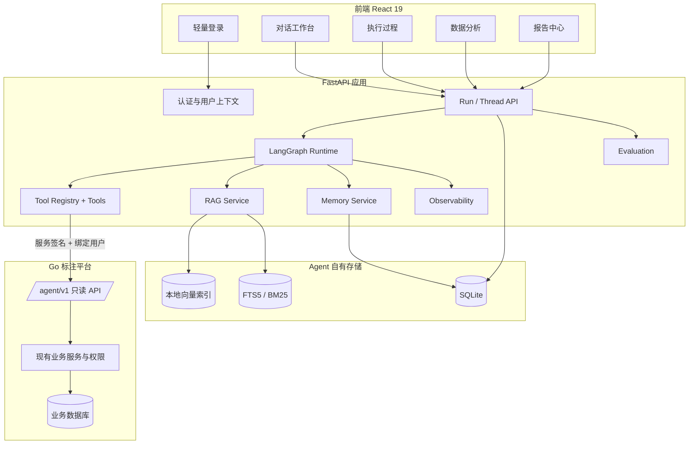

# 02 系统技术架构设计

**项目：** Annotation Ops Agent
**版本：** V1.0（定稿）
**日期：** 2026-11-02
**关联文档：** 《01 业务需求与功能清单》《03 分阶段开发任务与验收标准》

---

## 1. 架构原则

1. **独立系统。** Agent 拥有自己的前端、后端、数据库、部署单元，与 speech-mark 解耦。
2. **只读优先。** 第一阶段不存在任何写路径；写能力只作为未来规划。
3. **事实来自 Go。** 业务状态只以 Go 平台实时返回为准；Agent 数据库不保存第二份业务状态。
4. **统计用代码。** 计数、比率、聚合、分位数由 Go 聚合接口或 Python 确定性代码计算，LLM 只负责理解、规划、解释。
5. **工具即边界。** Agent 只能通过受控工具访问业务数据，不能发任意 HTTP、不能执行 SQL。
6. **证据可追溯。** 结论必须能回指到接口、时间范围、计算口径、规范版本与条款。
7. **渐进演进。** 单 Agent 起步；工具按 MCP-ready 设计但暂不接 MCP；RAG、Memory、多 Agent 分阶段引入。

---

## 2. 总体架构



**核心调用链：**

```text
React → FastAPI /api/agent/threads/{id}/runs
      → JWT 校验，得到 agent_user_id
      → 查绑定表得到 go_user_id
      → LangGraph 编排
          → LLM 选择工具
          → Tool 函数用 ToolContext 调 Go /agent/v1/*
          → Go 校验服务签名 + 绑定用户 + 业务权限
      → 汇总结果，生成四段式结论
      → 落库并返回 run_id / 答案 / 轨迹
```

---

## 3. 技术选型

| 层级 | 选型 | 说明 |
|---|---|---|
| 前端 | React 19 + Vite + Ant Design + React Router + TanStack Query | 独立工作台，不引入第二套 UI 体系 |
| 图表 | Ant Design Charts 或 ECharts | 与 AntD 风格一致 |
| 后端 | Python 3.12 + FastAPI + Uvicorn | 异步、类型友好 |
| 数据校验 | Pydantic v2 | 工具入参/出参、配置、API DTO |
| 编排 | LangChain + LangGraph | State / Node / Edge / Checkpoint / Interrupt |
| LLM | DeepSeek API | 模型与业务解耦，配置化切换 |
| 数据库 | SQLite + SQLAlchemy 2.x | 第一阶段轻量持久化 |
| 向量检索 | 本地向量库（Chroma 或等价方案） | 第二阶段引入，按评测结果决定 |
| 关键词检索 | SQLite FTS5 / BM25 | 规范编号、术语精确召回 |
| HTTP 客户端 | httpx | 超时、重试、连接池 |
| 日志 | 结构化 JSON（stdlib logging + 统一 formatter） | 全链路 request_id |
| 测试 | pytest + pytest-asyncio + httpx Mock | 单元 / 集成 / 契约 / 安全 |
| 部署 | 单机进程 + systemd 或容器（后续） | 第一阶段不引入 K8s / Redis |

版本策略：文档不锁定未验证的“最新版”；每阶段在 `pyproject.toml` / `uv.lock` 中锁定实际验证版本，升级必须跑回归。

---

## 4. 部署单元

| 单元 | 形态 | 说明 |
|---|---|---|
| `frontend` | 静态资源（Vite build） | 可由 Nginx 或 FastAPI 静态托管 |
| `backend` | Uvicorn 进程 | FastAPI + LangGraph + Tools |
| `sqlite` | 本地文件 | Agent 自身数据 |
| `knowledge` | 本地目录 + 索引文件 | 规范原文、切片、索引 |
| Go `/agent/v1` | 现有 Go 服务内新增路由 | 独立鉴权中间件，只读 |

第一阶段允许前后端与 Go 在同一台开发机运行；生产再接入内部网关和服务发现。

---

## 5. 身份、认证与权限

### 5.1 Agent 平台登录

- 独立轻量账号，用户名 + 密码（Argon2/bcrypt 哈希）。
- 登录成功签发 JWT（短期 access token；如需可加 refresh token）。
- JWT 只包含 `agent_user_id`、`role`、`exp`，不包含业务权限。
- 密码、密钥、Token 不落日志，不进入 Prompt。

### 5.2 用户绑定

```text
agent_users             # Agent 账号
user_platform_bindings  # agent_user_id -> go_user_id / 工号
```

- 绑定关系由管理员统一导入，普通用户只读。
- `status=disabled` 或未绑定 → 所有业务工具返回 `AGENT_USER_NOT_BOUND`。
- 绑定变更需要审计（谁、何时、改了什么）。

### 5.3 Go 侧服务鉴权

FastAPI 调用 `/agent/v1/*` 时携带：

| Header | 说明 |
|---|---|
| `X-Agent-Service` | 服务标识 |
| `X-Agent-Timestamp` | Unix 秒，允许 ±300s |
| `X-Agent-Nonce` | 随机串，防重放 |
| `X-Agent-Signature` | HMAC-SHA256(secret, service + timestamp + nonce + method + path + body) |
| `X-Agent-User` | 绑定后的 Go 用户 ID |
| `X-Request-Id` | 全链路追踪 ID |

Go 中间件处理顺序：

1. 校验服务标识与签名；
2. 校验时间窗口与 nonce（Redis 或本地缓存去重）；
3. 解析 `X-Agent-User`，查绑定关系；
4. 构造 `LoginAuthInfo`；
5. 进入业务 service 时复用现有项目/部门/工作组权限过滤；
6. 任何一步失败直接拒绝，不降级。

> 不允许只用 `X-Agent-User` 作为身份凭证；签名缺失时一律拒绝。

### 5.4 权限边界

- Agent 角色只决定“能用哪些功能”（如是否可看人员分析）；
- 数据范围由 Go 平台按绑定用户计算；
- Agent 不得缓存超出当前用户范围的业务数据；
- 缓存 key 必须包含 `go_user_id` 与数据范围版本。

---

## 6. Go `/agent/v1` 只读 API 契约

### 6.1 接口清单

| Method | Path | 用途 | 风险 |
|---|---|---|---|
| GET | `/agent/v1/me` | 当前绑定用户与数据范围 | R0 |
| GET | `/agent/v1/projects` | 可访问项目列表 | R1 |
| GET | `/agent/v1/projects/{id}/overview` | 项目概览 | R1 |
| GET | `/agent/v1/tasks` | 任务列表 | R1 |
| GET | `/agent/v1/tasks/{id}` | 任务详情 | R1 |
| GET | `/agent/v1/bundles` | 题包列表 | R1 |
| GET | `/agent/v1/bundles/{id}` | 题包详情 | R1 |
| GET | `/agent/v1/bundles/{id}/questions` | 题目摘要 | R2 |
| GET | `/agent/v1/questions/{id}/annotations` | 标注/审核摘要 | R2 |
| GET | `/agent/v1/users` | 人员列表 | R2 |
| GET | `/agent/v1/work-groups` | 工作组与成员 | R1 |
| GET | `/agent/v1/statistics/production` | 生产统计 | R1 |
| GET | `/agent/v1/statistics/quality` | 质量统计 | R1 |

### 6.2 统一响应

成功：

```json
{
  "ok": true,
  "data": {},
  "meta": {
    "request_id": "req_xxx",
    "fetched_at": "2026-11-02T08:00:00Z",
    "partial": false,
    "next_cursor": null
  },
  "warnings": []
}
```

失败：

```json
{
  "ok": false,
  "error": {
    "code": "PLATFORM_PERMISSION_DENIED",
    "message": "当前用户无权查看该题包",
    "retryable": false
  },
  "meta": {"request_id": "req_xxx"}
}
```

### 6.3 约定

- **方法**：仅 GET；`/agent/v1` 不注册任何写路由。
- **分页**：`page` + `page_size`（默认 20，上限 100）或 cursor；必须返回 `has_more` / `next_cursor`。
- **时间**：`start_time`、`end_time`，左闭右开，ISO 8601 带时区。
- **状态**：使用显式枚举，不使用魔法数字；枚举值在接口文档中固定。
- **字段**：白名单；默认不返回正文、音频地址、手机号等敏感字段。
- **限流**：按服务 + 用户维度限流，超限返回 `RATE_LIMITED` 且 `retryable=true`。
- **超时**：Go 侧单请求 ≤ 10s；慢查询需异步化，不在第一阶段做。
- **审计**：记录调用者、绑定用户、路径、参数摘要、耗时、结果行数。

### 6.4 副作用黑名单（禁止暴露）

- 领题 / 领包：`automaticQuestion`、`collect_topic_page`
- 投放 / 回收：`dataRelease`、`dataRecovery`、`re_release_topic_page`
- 结包 / 打回：`finish_batch`、`revert_finish_batch`、`task_mark_return`
- 保存答案：`save-runtime-answer`、`save-runtime-answer-claim`
- 任何 update / delete / create / import 接口

### 6.5 与现有 speech-mark 的映射（实施参考）

现有接口可直接支撑内部实现，但不直接暴露给 Agent：

| Agent 能力 | 现有接口（内部复用） |
|---|---|
| 项目 | `POST /v1/markproject/getProject`、`POST /v2/pro/detail` |
| 任务 | `POST /v1/marktask/list_task`、`/show_task`、`/task_detail` |
| 题包 | `POST /v1/marktaskbatch/batch_list`、`/batch_count_list`、`POST /v2/pro-manage/pkg-list` |
| 题目 | `POST /v1/marktopicdata/topicMarkSubjectList`、`/topicMarkViewPage` |
| 答案 | `POST /v1/marktopicdata/topicMarkView` |
| 人员 | `POST /v1/markUser/userList`、`/selectUser` |
| 工作组 | `POST /v2/work-group/list`、`/member/list` |
| 统计 | `POST /v1/marktaskbatch/topic_answer_distribution`、`/task_answer_distribution` |

实现注意：

- 现有接口多为 POST，且参数面向前端页面；`/agent/v1` 必须重新定义参数与返回，不复用页面 DTO。
- 现有响应为 `{ErrNo, ErrMsg, Data}`；Agent API 必须转换为 `{ok, data, meta, warnings}`。
- 现有鉴权为 Cookie `mark_session` + UUAP；Agent 走独立签名 + 绑定用户。
- 答案数据存在分表；跨题包统计必须走聚合接口，避免 Agent 拉全量。
- 状态枚举分散在各 service；接口文档必须显式列出并锁定。

---

## 7. 工具层设计

### 7.1 目录

```text
backend/app/tools/
├── registry.py
├── business/
│   ├── project_tools.py
│   ├── task_tools.py
│   ├── bundle_tools.py
│   ├── question_tools.py
│   ├── user_tools.py
│   └── group_tools.py
├── statistics/
│   ├── production_tools.py
│   └── quality_tools.py
├── analysis/
│   ├── anomaly_tools.py
│   └── efficiency_tools.py
└── common/
    ├── contract.py
    ├── context.py
    ├── pagination.py
    └── time_range.py
```

### 7.2 工具定义规范

```python
class ListBundlesInput(BaseModel):
    task_id: str = Field(..., description="任务 ID")
    status: Literal["unassigned", "in_progress", "done"] | None = None
    page: int = Field(1, ge=1)
    page_size: int = Field(20, ge=1, le=100)


async def list_bundles(args: ListBundlesInput, ctx: ToolContext) -> ToolResult:
    ...
```

强制要求：

1. 一个工具只负责一个明确业务能力；
2. 入参/出参均为 Pydantic 模型；
3. 身份只从 `ToolContext` 取，绝不从模型参数取；
4. 统一返回 `ToolResult`；
5. 设置超时；
6. 错误结构化；
7. 记录调用日志（脱敏）；
8. 强制分页与数量上限；
9. 标注风险等级（R0/R1/R2）；
10. 不允许任意 URL、任意 SQL、任意 HTTP 方法。

### 7.3 ToolContext

```python
@dataclass(frozen=True)
class ToolContext:
    request_id: str
    agent_user_id: str
    go_user_id: str | None
    project_scope: list[str]
    trace_id: str
```

### 7.4 统一契约

```python
class ToolMeta(BaseModel):
    request_id: str
    fetched_at: datetime
    partial: bool = False
    next_cursor: str | None = None

class ToolResult(BaseModel):
    ok: bool
    data: dict | list | None = None
    error: ToolError | None = None
    meta: ToolMeta
    warnings: list[str] = []
```

### 7.5 执行策略

| 项 | 策略 |
|---|---|
| 超时 | Go 请求 10s；工具总耗时 15s |
| 重试 | 仅幂等 GET，最多 2 次，指数退避 + 抖动 |
| 分页 | 工具最多自动取 3 页；超出标 `partial=true` |
| 并发 | 同一 Run 内工具并发上限 4 |
| 熔断 | 连续失败 5 次，暂停该工具 60s |
| 日志 | tool_name、参数摘要（脱敏）、行数、耗时、request_id |

### 7.6 MCP-ready

注册表统一保存：

```text
name / description / input_model / output_model / risk_level / timeout / handler
```

后续增加 `mcp_adapter.py`，把注册表映射为 MCP Tool 即可，业务函数零改动。**第一阶段不引入 MCP 依赖。**

---

## 8. LangGraph 编排

### 8.1 State

```python
class AgentState(TypedDict, total=False):
    request_id: str
    agent_user_id: str
    go_user_id: str | None
    project_scope: list[str]
    thread_id: str
    user_query: str
    intent: str
    time_range: dict
    plan: list[dict]
    tool_results: list[dict]
    metrics: dict
    findings: list[dict]
    evidence: list[dict]
    final_report: dict
    validation_errors: list[str]
    retry_count: int
    partial: bool
```

Reducer：

- `tool_results`：追加；
- `findings`：按 `finding_id` 去重合并；
- `retry_count`：替换；
- `validation_errors`：每轮开始时清空，避免污染。

### 8.2 主图（V0.2）

```text
START → load_scope → understand_intent → plan
      → need_tool? ──no──→ summarize → END
      → call_tool → validate → need_more? ──yes──→ call_tool
                                             └no──→ summarize → END
```

### 8.3 后续扩展

- 条件路由：查询类 / 分析类 / 报告类；
- 并行工具：同一步骤内多个独立查询；
- 反思：Draft → Verify → Detect Gap → Revise → Stop；
- 子 Agent（V0.8）：Quality / Knowledge / Root Cause / Planning；
- Interrupt/Resume：报告确认与未来审批。

### 8.4 停止条件

- 关键指标均有来源与口径；
- 规范引用匹配项目与有效版本；
- 无未解释的数据冲突；
- 补充查询最多 1–2 轮；
- 仍缺证据时输出“不确定”，不无限循环。

---

## 9. RAG 设计

### 9.1 知识范围

标注总体规范、项目专属规范、题型字段说明、版本更新记录、质检问题类型、历史争议案例、FAQ 与术语、指标定义。

### 9.2 流水线

```text
解析 → 清洗 → 按标题/条款切分 → 元数据 → Embedding + 关键词索引
问题 → Query Rewrite/Filter → 向量召回 + 关键词召回 → 融合 → Rerank
     → 权限与版本复核 → 返回片段与引用
```

### 9.3 切分原则

- 优先按章节标题和条款编号；
- 一个 Chunk 尽量表达一条完整规则；
- 表格保留表头与行关系；
- 长章节父子切分：子块检索、父块补上下文；
- 保留相邻条款关系；
- 条款编号、术语、版本建立关键词索引。

### 9.4 元数据

```json
{
  "document_id": "GUIDE-PROJ-001-V3",
  "project_id": "PROJECT-001",
  "document_type": "annotation_guideline",
  "version": "v3",
  "section_id": "2.4.1",
  "section_title": "说话人切分规则",
  "task_type": "speech_transcription",
  "language": "zh-CN",
  "effective_from": "2026-10-01T00:00:00Z",
  "effective_to": null,
  "permission_scope": ["project_admin", "quality_reviewer"],
  "source_file": "guideline-v3.pdf",
  "page_start": 12,
  "page_end": 13,
  "content_hash": "sha256:..."
}
```

权限过滤必须在检索阶段执行。

### 9.5 检索演进

V1 向量检索 → V2 关键词检索 → V3 混合检索（RRF） → V4 Rerank → V5 Query Rewrite / 父子块 / 版本过滤。

每步必须有评测集（Recall@K、MRR、nDCG、Citation Accuracy），不能只凭“看起来不错”。

### 9.6 引用规范

回答展示：规范名称、版本、章节/条款、页码（可得时）、命中原文、文档 ID。检索不到时必须明确说明。

---

## 10. Memory 设计

| 类型 | 内容 | 存储 | 能否作为业务事实 |
|---|---|---|---|
| 短期记忆 | 当前 Thread 状态、前文 | LangGraph Checkpoint（SQLite） | 否 |
| 长期语义记忆 | 项目约定、已确认经验 | `long_term_memories` | 否，仅辅助 |
| 情景记忆 | 历史问题与处理 | 运行记录 | 否 |
| 程序性记忆 | 报告模板、偏好 | 配置 / 用户偏好表 | 否 |
| 知识 | 规范与制度 | RAG 索引 | 依赖版本 |
| 业务数据 | 当前状态 | Go API | 是，唯一事实来源 |

### 10.1 写入规则

```text
发现可能有用的经验 → Memory Candidate
→ 隐私/未证实检查 → 管理员或授权用户确认
→ 写入长期记忆 → 检索时带来源与审核状态
```

模型不得在一次对话中自行写入长期记忆。

### 10.2 冲突与遗忘

- 新旧规范冲突：以有效版本为准；
- 记忆与 API 冲突：以 API 为准；
- 未审核候选不进入正式检索；
- 支持按用户/项目/类型失效；
- 过期经验设 TTL 或定期复核；
- 每条记忆保留来源与更新时间。

---

## 11. 数据模型（Agent 自有）

| 表 | 用途 | 关键字段 |
|---|---|---|
| users | Agent 用户 | id, username, password_hash, role, status |
| user_platform_bindings | 用户绑定 | agent_user_id, go_user_id, status, bound_by, bound_at |
| conversations | 会话 | id, user_id, title, created_at, updated_at |
| messages | 消息 | id, conversation_id, role, content, created_at |
| agent_runs | 运行记录 | id, thread_id, user_id, question, status, started_at, finished_at |
| tool_calls | 工具调用 | id, run_id, tool_name, args_redacted, result_summary, risk_level, partial, latency_ms |
| checkpoints | LangGraph 状态 | thread_id, checkpoint_id, state_json, created_at |
| user_preferences | 用户偏好 | user_id, key, value |
| knowledge_documents | 知识文档 | id, title, source, version, project_id, status |
| knowledge_chunks | 知识切片 | id, document_id, section_id, content, metadata_json |
| analysis_reports | 分析报告 | id, run_id, type, content_json, created_at |
| evaluation_records | 评测记录 | id, dataset, case_id, metrics_json, passed |
| long_term_memories | 长期记忆 | id, scope, type, content, source_run_id, status, expires_at |
| system_configs | 系统配置 | key, value, updated_at |

要求：统一主键；创建/更新时间；执行状态可查；常用过滤字段建索引；对话与运行记录支持分页；长期数据有清理策略；通过 Repository 隔离数据库实现。

---

## 12. FastAPI 接口

| Method | Path | 用途 |
|---|---|---|
| POST | `/api/auth/login` | 轻量登录 |
| POST | `/api/auth/logout` | 登出 |
| GET | `/api/auth/me` | 当前用户与绑定状态 |
| POST | `/api/agent/threads` | 创建会话 |
| GET | `/api/agent/threads` | 会话列表 |
| GET | `/api/agent/threads/{id}` | 会话详情 |
| DELETE | `/api/agent/threads/{id}` | 删除会话 |
| POST | `/api/agent/threads/{id}/runs` | 启动任务 |
| GET | `/api/agent/runs/{id}` | 运行状态 |
| GET | `/api/agent/runs/{id}/events` | 事件 / 流式输出（SSE） |
| GET | `/api/agent/runs/{id}/trace` | 节点与工具轨迹 |
| GET | `/api/agent/reports/{id}` | 报告详情 |
| GET | `/api/agent/tools` | 工具列表与状态 |
| GET | `/api/health` | 健康检查 |

约定：统一错误体；`request_id` 贯穿；流式输出用 SSE，不重写请求层；分页统一 `page/page_size`。

---

## 13. 前端设计

### 13.1 路由

```text
/login
/                     → /chat
/chat                 → 对话工作台
/chat/:threadId       → 指定会话
/analytics            → 数据分析
/reports              → 报告中心
/reports/:id          → 报告详情
/knowledge            → 知识库（V0.6 后）
/history              → 历史记录
/admin                → Agent 管理（V0.4 后）
/monitor              → 系统监控（V0.9 后）
```

### 13.2 状态与请求

- TanStack Query 管服务端状态；
- 轻量 Context/Zustand 管登录态与 UI 状态；
- Axios 实例：注入 JWT、统一错误提示、401 跳登录；
- 流式消息使用 SSE；
- 不保存 DeepSeek Key / Go 凭证。

### 13.3 对话页布局

| 区域 | 内容 |
|---|---|
| 左 | 会话列表、新建、搜索 |
| 中 | 消息流、Markdown、表格、图表、引用、追问 |
| 右 | 执行过程：节点、工具、参数摘要、耗时、重试 |
| 下/侧 | 业务结果：指标卡、异常证据、可展开明细 |

---

## 14. 可观测性

- **request_id**：前端生成或后端生成，贯穿 FastAPI → 工具 → Go。
- **结构化日志**：JSON；字段含时间、级别、模块、request_id、tool_name、latency_ms、rows、error_code。
- **Trace**：每个 Run 记录节点耗时、工具调用、重试、模型 tokens。
- **Metrics**：请求量、成功率、工具成功率、P50/P95 延迟、Token 消耗、错误分布。
- **脱敏**：Token、Cookie、密码、音频地址、标注正文不落日志。

---

## 15. 安全设计

| 项 | 措施 |
|---|---|
| 只读 | `/agent/v1` 仅 GET；无写工具；无 SQL 工具 |
| 身份 | JWT + 管理员导入绑定 + 服务签名 |
| 权限 | Go 侧按绑定用户重新鉴权，不信任 Agent 参数 |
| 数据最小化 | 字段白名单、摘要优先、按需详情 |
| Prompt Injection | 文档与工具结果视为数据；权限不因文档内容改变 |
| 越权测试 | 用户 A 不能读 B 的项目；参数不能覆盖身份上下文 |
| 凭证 | `.env` 不入 Git；日志不记录 |
| 审计 | 谁、何时、查什么、用什么规范、得出什么结论 |
| 写操作 | V1.0 前不开放；未来必须审批 + 幂等 + 版本校验 |

---

## 16. 配置与环境

```dotenv
APP_ENV=development
APP_SECRET_KEY=
DATABASE_URL=sqlite:///./data/app.db

LLM_PROVIDER=deepseek
DEEPSEEK_API_KEY=
DEEPSEEK_BASE_URL=
DEEPSEEK_MODEL=

ANNOTATION_API_BASE_URL=
AGENT_SERVICE_ID=
AGENT_SERVICE_SECRET=
ANNOTATION_API_TIMEOUT_SECONDS=10

RAG_ENABLED=false
VECTOR_STORE=local
LOG_LEVEL=INFO
```

`.env` 加入 `.gitignore`；`.env.example` 只保留变量名与占位符。

---

## 17. 目录结构

```text
speech-mark-agent-platform/
├── frontend/
│   ├── src/{pages,components,services,stores,hooks,layouts,styles}
│   ├── package.json
│   └── vite.config.ts
├── backend/
│   ├── app/
│   │   ├── api/
│   │   ├── agents/
│   │   ├── graphs/
│   │   ├── tools/{business,statistics,analysis,common}
│   │   ├── integrations/speech_mark/
│   │   ├── knowledge/
│   │   ├── memory/
│   │   ├── services/
│   │   ├── repositories/
│   │   ├── models/
│   │   ├── schemas/
│   │   ├── evaluation/
│   │   ├── observability/
│   │   └── core/
│   ├── tests/{unit,integration,contract,security,evaluation}
│   └── pyproject.toml
├── data/{app.db,knowledge,eval}
├── docs/
├── scripts/
├── .env.example
├── .gitignore
└── README.md
```

---

## 18. 架构决策记录（ADR）

| 编号 | 决策 | 理由 | 影响 |
|---|---|---|---|
| ADR-01 | 前端独立 React，不复用 Vue3 | 系统独立、迭代自由 | 需要独立登录与 UI 体系 |
| ADR-02 | 轻量登录 + 管理员绑定 | 不依赖现有登录，同时保留业务权限 | 需要绑定表与 Go 侧重新鉴权 |
| ADR-03 | 工具先纯函数，MCP-ready | 降低第一阶段复杂度 | 后续包 MCP 只需适配层 |
| ADR-04 | 单 Agent 起步 | 便于定位问题 | 多 Agent 延后到 V0.8 |
| ADR-05 | Go 提供 `/agent/v1` 只读 API | 避免 Agent 拼底层接口 | Go 侧需少量新增代码 |
| ADR-06 | 统计用确定性代码 | 避免 LLM 编数字 | 需要指标服务与口径管理 |
| ADR-07 | RAG 延后到 V0.6 | 先打通数据与工具 | 前期规范能力较弱 |
| ADR-08 | SQLite 第一阶段 | 轻量、易部署 | 多实例时需迁移 |

---

## 19. 风险与技术债

| 风险 | 影响 | 应对 |
|---|---|---|
| Go `/agent/v1` 排期不确定 | 阻塞 V0.4 | 先用 Mock 工具开发，接口就绪后切换 |
| 绑定数据不完整 | 用户看不到数据 | 提供绑定状态页与明确错误 |
| 现有接口字段不稳定 | 工具返工 | 接口契约冻结 + 契约测试 |
| LLM 编造数字 | 结论不可信 | 数字只来自工具，回答模板限制 |
| 反思循环失控 | 成本与延迟 | 最大轮次 + 停止条件 |
| RAG 召回差 | 规范结论不可用 | 混合检索 + 评测集驱动 |
| 敏感数据外泄 | 合规风险 | 最小字段 + 脱敏 + 审计 |
